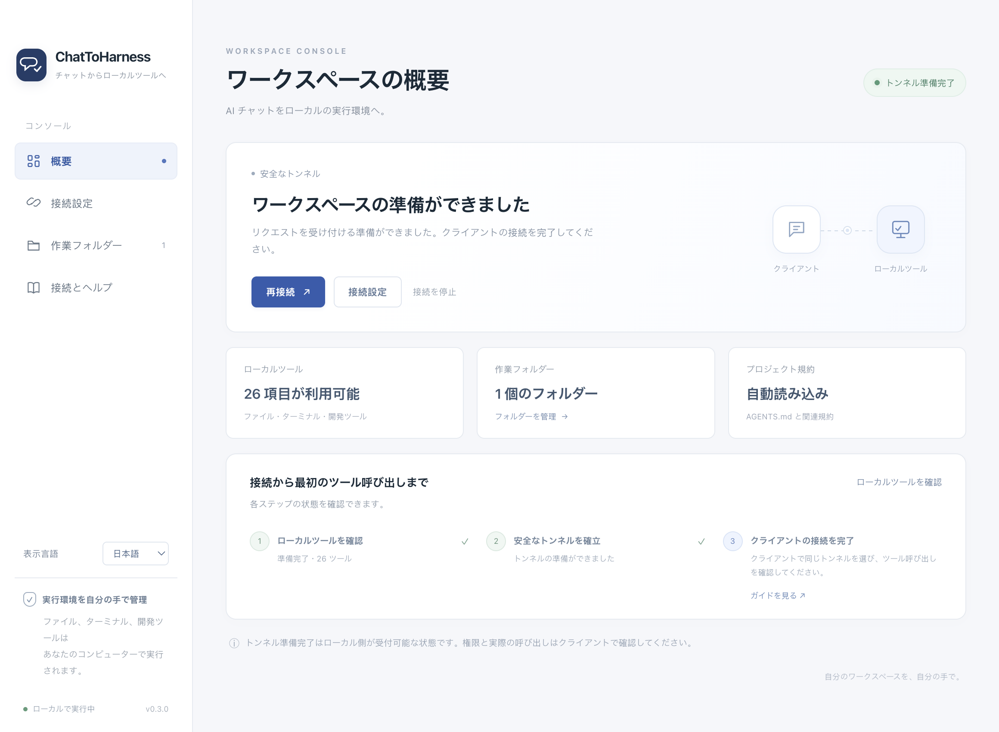
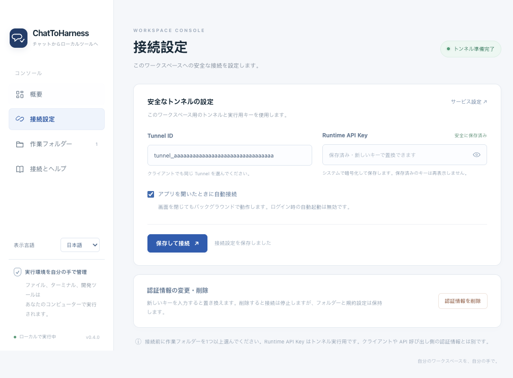

<p align="center">
  <a href="https://dj-huang.github.io/ChatToHarness/ja/"></a>
</p>
<h1 align="center">ChatToHarness</h1>
<p align="center">
  <a href="https://dj-huang.github.io/ChatToHarness/ja/">公式サイト・ダウンロード</a> · <a href="https://github.com/DJ-Huang/ChatToHarness/releases">GitHub Releases</a>
</p>
<p align="center">
  <a href="README.md">English</a> | <a href="README.zh-CN.md">简体中文</a> | <a href="README.ja.md">日本語</a>
</p>
<p align="center"><strong>AI チャットをローカルの実行環境へ。</strong></p>

安全なトンネルを通じて、対応する AI クライアントからローカルのファイル、ターミナル、Git、開発ツールを利用できます。ツール操作の前に、適用されるプロジェクト規約を届けます。

## スクリーンショット

### アプリの概要



### 接続設定：デモ用 Tunnel ID を使用し、実際の認証情報は含みません。



### ChatGPT


ChatGPT：`@` で接続済みプラグインを選び、タスクとプロジェクトのパスを入力します。既存のプラグイン名は LocalHarness のままです。この画像は入力例であり、ツール呼び出しの成功を示すものではありません。

アプリの画像は独立したデモ設定で撮影しています。アプリ、サイト、文書は日本語・英語・中国語に対応しています。サイドバーの「表示言語」で即座に切り替え、接続を再起動せずに選択を保存できます。

## はじめに

1. 公開済み Release から macOS 14+ Apple Silicon または Windows 11 x64 用のインストーラーを入手します。
2. サービス管理画面で Tunnel ID と Runtime API Key を用意し、アプリに入力して作業フォルダーを選びます。
3. 保存して接続します。トンネルの準備ができたら、クライアントガイドに従って ChatGPT または Codex を接続します。
4. まず読み取り専用のタスクを試し、その後、専用の一時フォルダーでファイルの書き込みを確認します。

[OpenAI Tunnel](https://platform.openai.com/settings/organization/tunnels) · [クライアント接続](docs/ja/CLIENTS.md)

## 主な機能

- Desktop Commander を介してローカルのファイル、Shell、Git、既存の開発コマンドを使用。
- 任意の AGENTS.md と共有規約の必要時読み込み。規約に問題があっても読み取りと調査は継続。
- 行コンテキスト、ページ分割、キャンセルに対応する上限付き ripgrep 検索。
- 手動・自動の更新確認と、整合性を検証するインストーラーのダウンロード。
- メニューバー／トレイ操作、バックグラウンド実行、認証情報の暗号化保存、ツール操作を再実行しない再接続。

フォルダー設定はターミナルのサンドボックスではありません。コマンドは現在のユーザー権限で実行されます。キーはローカルアプリにのみ入力してください。「トンネル準備完了」はクライアント呼び出しの検証完了を意味しません。

## ドキュメント

[利用ガイド](docs/ja/GUIDE.md) · [クライアント接続](docs/ja/CLIENTS.md) · [アーキテクチャ](docs/ja/ARCHITECTURE.md) · [ビルドとリリース](docs/ja/RELEASING.md) · [検証記録](docs/ja/VERIFICATION.md) · [第三者ソフトウェア](docs/ja/THIRD_PARTY_NOTICES.md) · [ライセンス](docs/ja/LICENSE.md)

[English](docs/en/README.md) · [简体中文](docs/zh-CN/README.md) · [日本語](docs/ja/README.md)

## 開発

[Dev.command](Dev.command)（Mac）または [Dev.cmd](Dev.cmd)（Windows）で現在のソースを直接実行します。再実行時は旧インスタンスを終了してから新コードを読み込みます。依存関係があれば `npm run dev` / `npm start` も使え、パッケージ作成は不要です。[開発ガイド](docs/ja/GUIDE.md#開発時にソースを直接実行)

Node 24.22.0 を使用し、対象と同じ OS・アーキテクチャでビルドします。

```sh
npm ci
npm run dev
npm test
npm run build
npm run dist
```

MIT ライセンス。英語の原文を正式版とし、中国語・日本語の参考訳をドキュメントに掲載しています。
