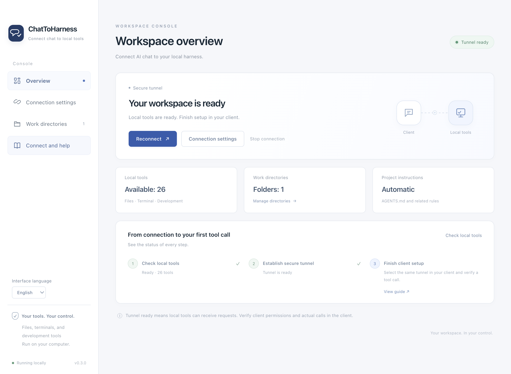
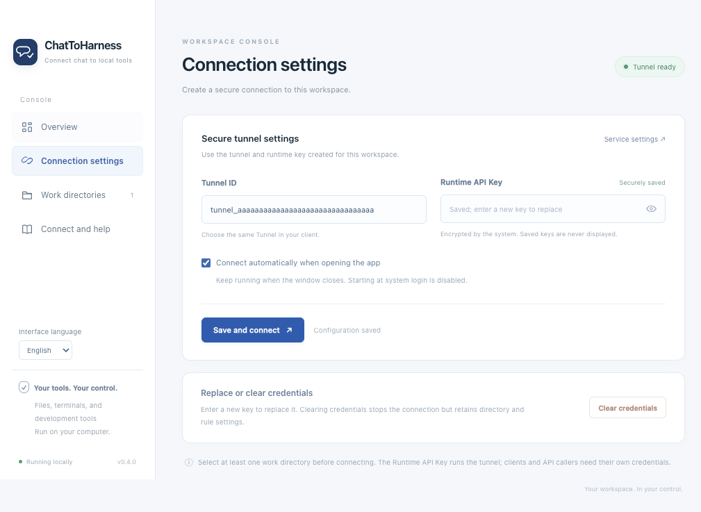
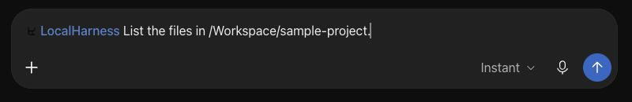

<p align="center">
  <a href="https://dj-huang.github.io/ChatToHarness/en/"></a>
</p>
<h1 align="center">ChatToHarness</h1>
<p align="center">
  <a href="https://dj-huang.github.io/ChatToHarness/en/">Website & downloads</a> · <a href="https://github.com/DJ-Huang/ChatToHarness/releases">GitHub Releases</a>
</p>
<p align="center">
  <a href="README.md">English</a> | <a href="README.zh-CN.md">简体中文</a> | <a href="README.ja.md">日本語</a>
</p>
<p align="center"><strong>Connect AI chat to your local harness.</strong></p>

A desktop console for connecting supported AI clients to local files, terminals, Git, and development tools through a secure tunnel. Project instructions are delivered before tool operations.

## Screenshots

### Application overview



### Connection settings — demonstration Tunnel ID, no real credentials.



### ChatGPT



ChatGPT: select the connected plugin with `@`, then describe the task and project path. The existing plugin retains its original LocalHarness name. This screenshot shows task composition, not a successful tool response.

Application screenshots use an isolated demonstration configuration. The app, website, and documentation support English, Simplified Chinese, and Japanese. Change the app language with **Interface language** in the sidebar; the selection is remembered without restarting the connection.

## Get started

1. Install the package for macOS 14+ Apple Silicon or Windows 11 x64 from a published Release.
2. Prepare a Tunnel ID and Runtime API Key in the service console, enter them in the application, and select work directories.
3. Save and connect. When the tunnel is ready, follow the client guide for ChatGPT or Codex.
4. First try a read-only task, then verify file writing in a dedicated temporary directory.

[OpenAI Tunnel](https://platform.openai.com/settings/organization/tunnels) · [Client connections](docs/en/CLIENTS.md)

## Capabilities

- Local files, shell, Git, and existing development commands through Desktop Commander.
- Automatic AGENTS.md loading, relevant rules on demand, and project context checked on each operation.
- Menu bar/system tray controls, background operation, encrypted credential storage, and reconnection without replaying tool operations.

Folder settings do not sandbox the terminal: commands run with your current user permissions. Keep API keys in the local application. “Tunnel ready” does not mean a client call has been verified.

## Documentation

[User guide](docs/en/GUIDE.md) · [Client connections](docs/en/CLIENTS.md) · [Architecture](docs/en/ARCHITECTURE.md) · [Build & release](docs/en/RELEASING.md) · [Verification record](docs/en/VERIFICATION.md) · [Third-party notices](docs/en/THIRD_PARTY_NOTICES.md) · [License](docs/en/LICENSE.md)

[English](docs/en/README.md) · [简体中文](docs/zh-CN/README.md) · [日本語](docs/ja/README.md)

## Development

Use Node 24.22.0. Build on the matching target operating system and architecture.

```sh
npm ci
npm test
npm run build
npm run dist
```

MIT. The English license is authoritative; Chinese and Japanese reference translations are available in the documentation.
