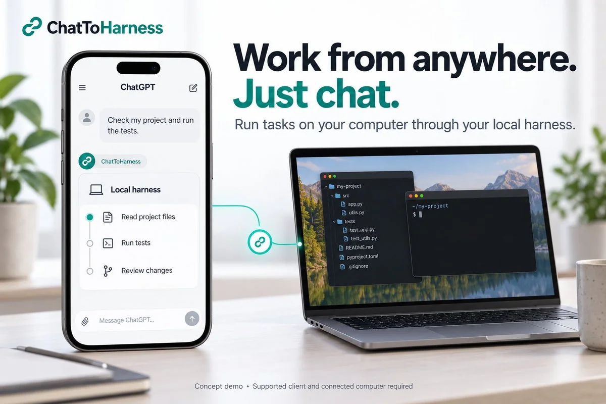
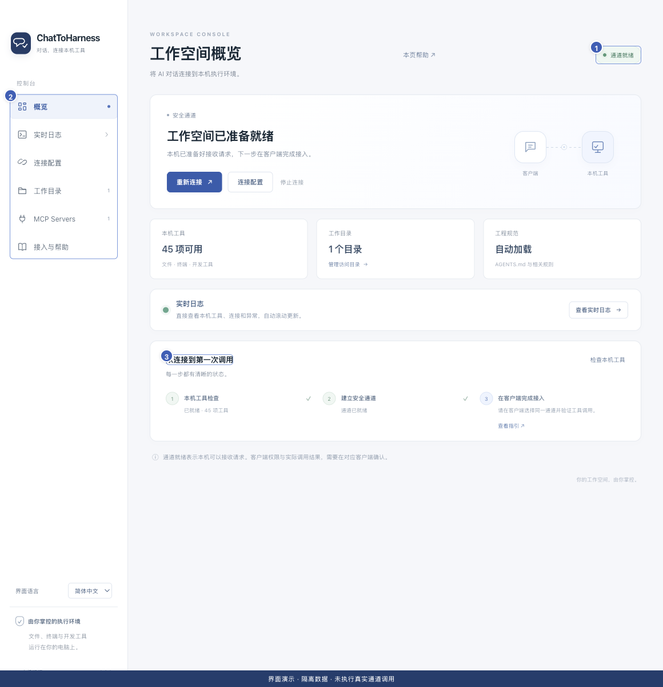
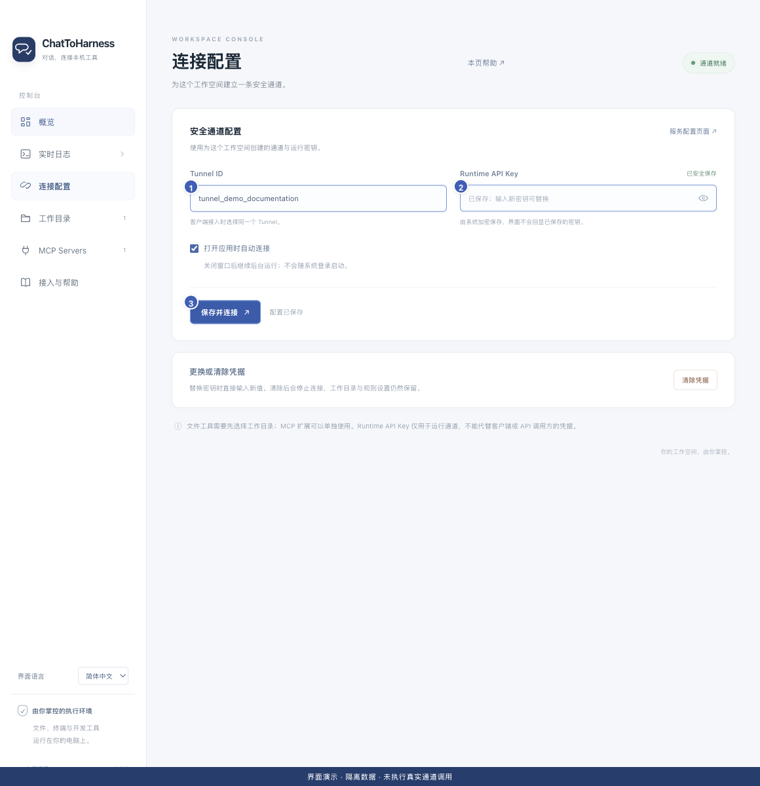
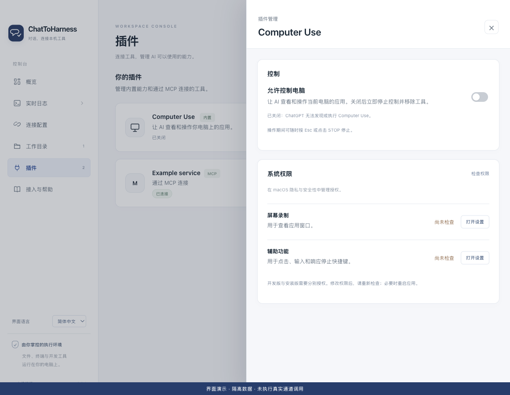

<p align="center">
  <a href="https://dj-huang.github.io/ChatToHarness/"></a>
</p>
<h1 align="center">ChatToHarness</h1>
<p align="center">
  <a href="https://dj-huang.github.io/ChatToHarness/">官网与下载</a> · <a href="https://github.com/DJ-Huang/ChatToHarness/releases">GitHub Releases</a>
</p>
<p align="center">
  <a href="README.md">English</a> | <a href="README.zh-CN.md">简体中文</a> | <a href="README.ja.md">日本語</a>
</p>
<p align="center"><strong>将 AI 对话连接到本机执行环境。</strong></p>

通过安全通道，将支持的 AI 客户端连接到本机文件、终端、Git 和开发工具；在工具操作前自动交付适用的工程规范。



## 截图

### 应用概览



### 连接配置：使用演示 Tunnel ID，不含真实凭据。



### Computer Use — 实验功能



在已授权窗口中查看截图，再由接入的客户端执行点击、输入、滚动或拖动。从**插件 → Computer Use → 管理**检查权限并主动开启内置功能，支持 Windows x64 与 macOS arm64；按 **Esc / STOP** 可结束控制。[设置与使用](docs/zh-CN/GUIDE.md)

*macOS 界面演示，使用隔离数据：控制关闭、权限尚未检查，未执行真实桌面输入。*

### ChatGPT


ChatGPT：通过 `@` 选择已连接插件，再描述任务和工程路径。已有插件沿用原名 LocalHarness。此截图展示任务编写，不代表工具调用成功。

应用截图使用隔离的演示配置。软件、官网和文档均支持中文、英文、日文；在软件侧栏「界面语言」中即时切换并记住选择，无需重启连接。

## 快速开始

下载前，先确认账户可以使用支持 Tunnel 的 ChatGPT 自定义 MCP 或 Codex 接入入口。创建或编辑 Tunnel 需要 **Tunnels Read + Manage**；运行通道及在客户端选择通道需要 **Read + Use**。请关联目标 Platform 组织与 ChatGPT 工作区，并检查工作区的自定义 MCP 权限。[权限检查清单](https://developers.openai.com/api/docs/guides/secure-mcp-tunnels#permissions-and-access)

先阅读 Release 的签名说明：当前 Windows 安装包未签名，Mac 应用为临时签名且未公证，系统可能提示或阻止安装。下载后请核对 `SHA256SUMS.txt`。

1. 从正式发布的 Release 下载适用于 macOS 14+ Apple 芯片或 Windows 11 x64 的安装包。
2. 在服务控制台准备 Tunnel ID 与 Runtime API Key，填入本机应用，并选择工作目录。
3. 保存并连接。通道就绪后，按客户端指引接入 ChatGPT 或 Codex。
4. 先尝试只读任务，再在专用临时目录验证文件写入。

首次只读检查可使用：“用 `get_harness_status` 报告实际运行版本，再用 `get_project_overview` 查看 `<工程绝对路径>`，不要修改文件。”请选择已在应用中授权的目录。只有客户端返回真实工具结果后，才算接入验证成功；随后在专用临时目录测试一个新的标记文件，不要使用已有工程文件。客户端确认仍独立于本机应用权限。

[OpenAI Tunnel](https://platform.openai.com/settings/organization/tunnels) · [客户端接入](docs/zh-CN/CLIENTS.md)

## 主要能力

- 通过 Desktop Commander 使用本机文件、Shell、Git 和现有开发命令。
- AGENTS.md 可选，按需读取共享规范；规范异常不阻断读取和排查。
- 有上限的 ripgrep 搜索，支持行上下文、分页和取消。
- 应用级 MCP 扩展、按项目／工具记忆授权，以及仅针对已启用且受信任服务的可选全工具放行。
- 实际构建／连接状态、Git 只读检查、AGENTS／规则／Skills 索引、幂等后台任务、安全 SHA 文本编辑及撤销。
- 支持客户端协商后的原生 MCP 资源／提示词及只读工具回退。
- Windows x64 与 macOS arm64 内置实验性 Computer Use，支持已授权窗口的截图及真实鼠标、键盘输入。首次使用默认关闭，已保存的开关状态继续沿用；需要启用时，在**插件 → Computer Use → 管理**中确认权限。macOS 需要屏幕录制与辅助功能权限。保留窗口授权、用户接管和 STOP / Esc；GUI 规划能力取决于接入的客户端。[设置与使用](docs/zh-CN/GUIDE.md)
- 实时日志与执行记录，区分本机执行和回传状态，支持筛选、总量限制和临时详细诊断。

- 手动及自动检查更新，安装包通过完整性校验后才打开。
- 菜单栏／托盘控制、后台运行、凭据加密保存，重连时不重放工具操作。

目录设置不构成终端沙箱，命令按当前用户权限执行。密钥只填入本机应用。“通道就绪”不等于客户端调用已验证。

## 文档

[使用文档](docs/zh-CN/README.md) · [官网帮助中心](https://dj-huang.github.io/ChatToHarness/docs/zh-CN/)

[使用指南](docs/zh-CN/GUIDE.md) · [客户端接入](docs/zh-CN/CLIENTS.md) · [架构](docs/zh-CN/ARCHITECTURE.md) · [构建与发布](docs/zh-CN/RELEASING.md) · [验证记录](docs/zh-CN/VERIFICATION.md) · [第三方声明](docs/zh-CN/THIRD_PARTY_NOTICES.md) · [许可证](docs/zh-CN/LICENSE.md)

[English](docs/en/README.md) · [简体中文](docs/zh-CN/README.md) · [日本語](docs/ja/README.md)

## 开发

Computer Use 开发资料：[Windows 原生设置与验证](docs/windows-computer-use.md) · [跨平台任务架构](docs/computer-use-agent-architecture.md)。Windows 和 macOS 安装包已包含内置插件；实验状态及已知限制见 [v0.8.1 发布说明](release-notes/v0.8.1.md)。

双击 [Dev.command](Dev.command)（Mac）或 [Dev.cmd](Dev.cmd)（Windows），直接运行当前源码；再次启动会先清理旧实例，再运行新代码。Mac 终端可运行 `./dev.sh`。已有依赖也可使用 `npm run dev` / `npm start`，无需打包。[开发说明](docs/zh-CN/GUIDE.md#开发时直接运行源码)

使用 Node 24.22.0，在与目标一致的操作系统和架构上构建。

```sh
npm ci
npm run dev
npm test
npm run build
npm run dist
```

MIT 许可证，以英文原文为准；文档中提供中文和日文参考译文。
