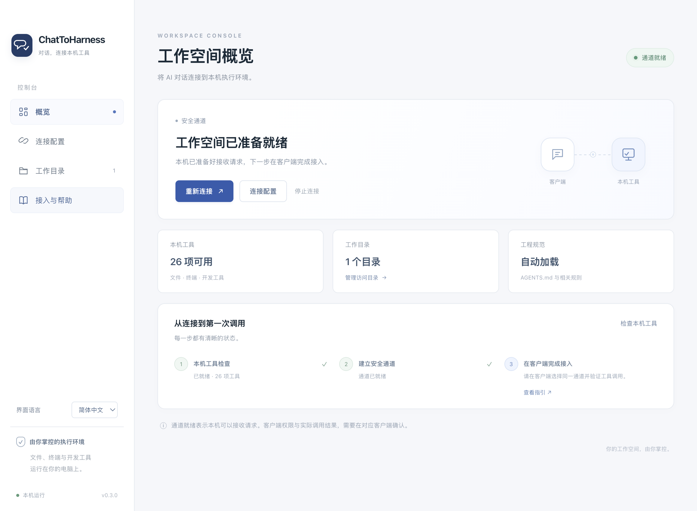
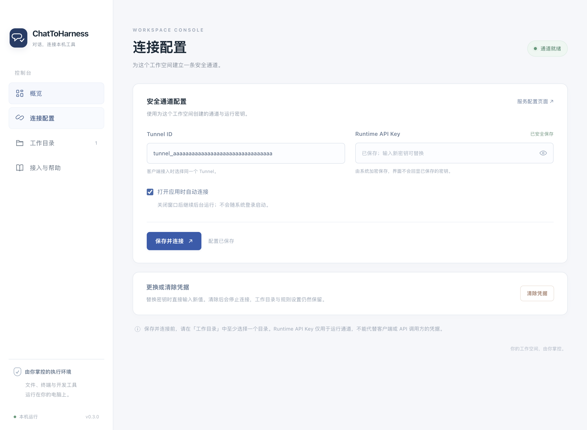

# ChatToHarness

**[官网与下载](https://dj-huang.github.io/ChatToHarness/)** · [GitHub Releases](https://github.com/DJ-Huang/ChatToHarness/releases)

[English](README.md) | [简体中文](README.zh-CN.md) | [日本語](README.ja.md)

**将 AI 对话连接到本机执行环境。**

通过安全通道，将支持的 AI 客户端连接到本机文件、终端、Git 和开发工具；在工具操作前自动交付适用的工程规范。

## 截图

### 应用概览



### 连接配置：使用演示 Tunnel ID，不含真实凭据。



### ChatGPT


ChatGPT：通过 `@` 选择已连接插件，再描述任务和工程路径。已有插件沿用原名 LocalHarness。此截图展示任务编写，不代表工具调用成功。

应用截图使用隔离的演示配置。当前应用界面为中文，文档提供中、英、日三种语言。

## 快速开始

1. 从正式发布的 Release 下载适用于 macOS 14+ Apple 芯片或 Windows 11 x64 的安装包。
2. 在服务控制台准备 Tunnel ID 与 Runtime API Key，填入本机应用，并选择工作目录。
3. 保存并连接。通道就绪后，按客户端指引接入 ChatGPT 或 Codex。
4. 先尝试只读任务，再在专用临时目录验证文件写入。

[OpenAI Tunnel](https://platform.openai.com/settings/organization/tunnels) · [客户端接入](docs/zh-CN/CLIENTS.md)

## 主要能力

- 通过 Desktop Commander 使用本机文件、Shell、Git 和现有开发命令。
- 自动加载 AGENTS.md、按需读取相关 rules，每次操作校验工程上下文。
- 菜单栏／托盘控制、后台运行、凭据加密保存，重连时不重放工具操作。

目录设置不构成终端沙箱，命令按当前用户权限执行。密钥只填入本机应用。“通道就绪”不等于客户端调用已验证。

## 文档

[使用指南](docs/zh-CN/GUIDE.md) · [客户端接入](docs/zh-CN/CLIENTS.md) · [架构](docs/zh-CN/ARCHITECTURE.md) · [构建与发布](docs/zh-CN/RELEASING.md) · [验证记录](docs/zh-CN/VERIFICATION.md) · [第三方声明](docs/zh-CN/THIRD_PARTY_NOTICES.md) · [许可证](docs/zh-CN/LICENSE.md)

[English](docs/en/README.md) · [简体中文](docs/zh-CN/README.md) · [日本語](docs/ja/README.md)

## 开发

使用 Node 24.22.0，在与目标一致的操作系统和架构上构建。

```sh
npm ci
npm test
npm run build
npm run dist
```

MIT 许可证，以英文原文为准；文档中提供中文和日文参考译文。
