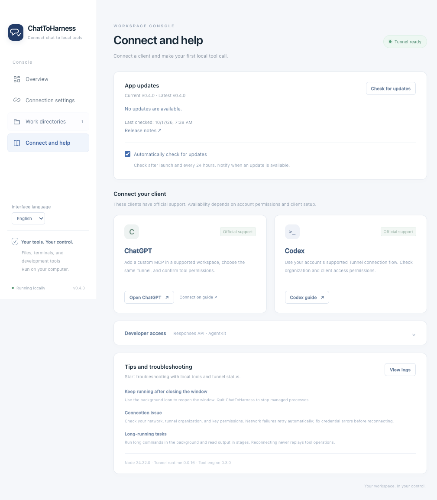

# ChatToHarness User Guide

[English](../en/GUIDE.md) | [简体中文](../zh-CN/GUIDE.md) | [日本語](../ja/GUIDE.md)

**Connect AI chat to your local harness.**

ChatToHarness is a desktop console that lets supported clients use local files, terminals, Git, and development tools through a secure tunnel. Applicable project instructions are delivered before tool operations.

[Documentation](README.md) · [Website and downloads](https://dj-huang.github.io/ChatToHarness/en/) · [Releases and checksums](https://github.com/DJ-Huang/ChatToHarness/releases) · [Clients](CLIENTS.md) · [Architecture](ARCHITECTURE.md) · [Verification](VERIFICATION.md) · [Release maintenance](RELEASING.md)

## Installation and use

Supported targets are macOS 14+ on Apple Silicon and Windows 11 x64. Installers include Node, the Tunnel runtime, and Desktop Commander; a separate development environment is not required. Read the signing status in the corresponding Release before installing. Default builds are unsigned on Windows and ad-hoc signed without notarization on Mac, so the operating system may warn or block installation.

1. Download the matching `.dmg` or `-setup.exe` from a published Release, install it, and open the application.
2. Create or select a Tunnel in the [service console](https://platform.openai.com/settings/organization/tunnels) and prepare a Runtime API Key. The relevant organization or workspace must have permission to use the tunnel.
3. Enter the Tunnel ID and Runtime API Key in **Connection settings**. In **Work directories**, select the folders that file tools may access.
4. Choose **Save and connect**. After local checks succeed and the status is **Tunnel ready**, follow **Connection and help** to configure the client.
5. Start with a read-only client request, then verify writing and reading in a dedicated temporary directory.

Use **Interface language** in the sidebar to switch between English, Simplified Chinese, and Japanese immediately. The first launch follows your system language (other languages fall back to English); later launches remember your choice. Native menus, tray actions, status, help, and errors change together. The separate `preferences.json` stores language and update-check preferences and does not read or rewrite credentials or reconnect the tunnel. The website has its own language selector and remembers your browser choice.

Do not send API keys in chat or commit them to the repository. The application saves only system-encrypted credentials, reports only whether a key is saved, and clears the key input after saving. Only the Tunnel receives the Runtime API Key; tool processes do not. API callers need separate credentials.

Closing the window keeps the application running in the background. Left-click the system tray/menu bar icon to open the window; right-click for connection, stop, logs, and quit actions. **Stop connection** stops the tunnel and all managed MCP services; **Quit ChatToHarness** cleans up managed processes and exits. Launching again restores the existing window. Starting at login is disabled by default.

**Tunnel ready** confirms the tunnel and local tools are available. It does not confirm that a client has been configured or has successfully called a tool.

## MCP Servers

This section describes new source functionality that is not included in the published v0.4.0 installers. Use the source development entry point or a local build.

Configure services in **MCP Servers** in ChatToHarness. These are application settings shared by the Tunnel's clients; you do not attach each service to a particular Agent. Built-in file and terminal tools keep their existing names. Unity, browsers and other integrations connect as ordinary MCP services, without app-specific logic in ChatToHarness. No work directory is needed for third-party services; built-in file tools still require authorized folders.

1. Add a service with a stable server ID, display name and transport. `stdio` requires a command and argument list, with optional working directory, environment values and Mac/Windows overrides. Streamable HTTP requires a URL and optional static request headers. Remote URLs require HTTPS; HTTP is limited to loopback. OAuth and legacy HTTP+SSE are not supported.
2. Save credentials through the app's secret fields. System-encrypted values stay in local secret storage; service configurations and exports contain references. The app never returns saved secrets to the page. Configure only the environment values a service needs; it runs with your user permissions and is not confined by the file-tool directory list.
3. Before connecting, inspect the exact command or URL and confirm trust. Changing the launch target requires trust again. **Test connection** reuses a healthy connection; it does not call discovered tools. The preview shows connection state and negotiated protocol.
4. Set each discovered tool to disabled, direct call, or local confirmation on every call. New tools start disabled; changed definitions require authorization again. Read-only hints from a server do not grant access. A local confirmation applies only to the displayed tool, arguments and connection, and must finish within the call deadline.
5. Enable and connect the service, then refresh the tool catalog in your client if needed. External names use `serverId__toolName`, for example `unity__get_scene`. Configuration, trust and call approvals remain in the desktop app.

JSON import accepts the app's export format and common `mcpServers` configurations. Inspect the preview before importing; imported services are disabled and import never runs a command. Export omits secret values, trust decisions and tool authorizations. Re-enter missing secret values locally and authorize tools before connecting an imported service.

Disabling a service stops only that service. **Stop connection** stops the Tunnel and all managed services; closing the window keeps them in the background. Transport failures reconnect independently without repeating calls. If a forwarded call loses its reply, inspect the target application's state before retrying. Authentication, configuration and protocol errors need correction. SDK `1.32.1` cannot connect to a peer that requires only protocol `2026-07-28`.

Calls have a 60-second default deadline and a 90-second maximum, including confirmation, with an 8 MiB serialized message limit. Results may include structured content and images. Only tools are aggregated; resource/prompt browsing, sampling and elicitation are not provided. Diagnostic logs omit call arguments, result bodies and images. **Tunnel ready** does not establish that a newly added tool has been discovered or called by your client.

## App updates

Use **App updates** in **Connection and help** to check versions and read release notes. The application and tray menus also offer **Check for updates**. An available update appears in the sidebar.

Automatic checks run 10 seconds after launch and every 24 hours thereafter, and can be disabled. Checks need no tunnel or API key; failures do not interrupt tools or connections. Automatic checks only notify. Downloading and installing require your click. The preference is stored alongside language in the separate `preferences.json`, without rewriting credentials or reconnecting.

**Download and install** downloads the matching installer and verifies its size and SHA-256. After verification, the app stops the connection, opens the installer, and quits. On Mac, drag the new version from the DMG into Applications; Windows uses the installer wizard. Save or discard unsaved configuration changes and finish running tool tasks first. Development mode checks versions only. Missing assets, download failures, or invalid checksums do not start installation.



This screenshot uses isolated demonstration settings and a synthetic update response; it does not establish a real tunnel call.

## Automatic project instructions

Enabled by default. Give the client the task and project directory. File, search, and terminal tools may also specify `project_path` as the instruction root.

- AGENTS and rules are optional. Reads, directory listings, and searches execute directly with guidance or diagnostics. Valid `project_context_tokens` reuse previously delivered bodies.
- Root-to-target `AGENTS.md` / `agents.md` apply within their scopes. If a first write needs undelivered guidance, it returns the bodies and retry tokens without execution. The client reads them and retries. Projects without instructions allow direct writes.
- Ordinary references, missing files, and documentation patterns such as `{en,zh-CN,ja}` are diagnostics, not execution prerequisites. Relative references use the containing AGENTS directory. Shared rules outside the project may be read within authorized folders, without expanding target scope or write permissions.
- Conflicting, unreadable, or oversized applicable AGENTS block writes only; reads remain available. `get_project_context` explicitly loads projects, target paths, and selected `rule_paths`; failure to read a requested rule affects that call only.
- Delivered bodies total at most 64 KiB and are never silently truncated. Changes to delivered guidance require rereading; unrelated index changes do not block writes. File and directory metadata invalidate caches and detect added, removed, and nested instructions.

Both file and rule access enforce the app's authorized folders after resolving symbolic links. Change folders in the desktop app; `set_config_value` cannot change `allowedDirectories`. Project text cannot override user or platform instructions. Delivery does not prove model compliance.

## Search and recovery

Prefer `search_project` for code: supply `project_path` and `pattern`. It defaults to literal content matching; `regex` enables regular expressions, `ignore_case` ignores case, and `search_type="files"` searches filenames/globs. Use `include_globs` and `exclude_globs` to narrow the scope. Ignore rules and binary-file skipping apply by default. Results contain absolute paths, 1-based line numbers, and two surrounding lines on each side. `read_file` offsets remain 0-based: line N uses offset N−1.

Defaults are 100 results per page and a 2-second search budget, configurable up to 10 seconds. One search stores at most 1,000 matches and 2 MiB; a result page is at most 64 KiB, separate from the guidance budget. Timeout, count/byte limits, partial access, and no matches have distinct states. Long lines/snippets are marked when truncated. `next_cursor` reads the stored snapshot without rescanning, binds the project and query, and expires after five idle minutes. Up to four new searches run concurrently. Existing streaming search tools remain available.

The gateway allows 60 seconds per call by default and at most 90 seconds including any local confirmation. The internal built-in proxy's longer explicit wait cannot extend that total deadline. A timeout before forwarding reports `execution_state="not_started"`; a forwarded timeout reports `"unknown"`. Writes, appends, moves, and commands are never automatically replayed. Reads/searches can be retried after inspecting state. Stopping known processes or searches does not require refreshed rules. Handles lost on reconnection produce an explicit error.

Folder settings **do not sandbox the terminal**. Shell commands retain the user's permissions and real environment. Declare related `context_paths`, or `[]` for ordinary system diagnostics. Run long tasks in the background and read output incrementally. Stop and Quit clean up managed processes.

## Run source during development

Double-click `Dev.command` on Mac or `Dev.cmd` on Windows. The first run prepares pinned Node, Electron and tool components and needs network access. Later runs load current `app/` source **without packaging an app or installer**. With dependencies installed, `npm run dev` and `npm start` provide the same development entry.

After editing code, launch that entry again to restart; it does not watch file saves. The old instance receives a graceful Quit request, stops its tunnel and tools, cancels reconnects and releases the single-instance lock before the new instance loads source. Existing directories, credentials and preferences retain their storage. A new executable may require first-use keychain authorization.

Keep the development terminal open. Ctrl+C or closing it ends that development run. Closing the app window still hides it in the background; launching the development entry again replaces it. Restarting ends active tool tasks.

For the first switch from an older version without the restart protocol, select **Quit ChatToHarness** once from its menu; closing the window is insufficient. If the old instance stays alive, the launcher fails clearly after at most 15 seconds rather than starting a second service. Subsequent development restarts use the one-click entry. If Windows reports that a changed pinned dependency is in use, quit the old development instance before preparing it again.

## One-click source launcher

Double-click `Start.command` on Mac or `Start.cmd` on Windows. The first launch prepares locked dependencies and builds the application; later launches reuse it. Initial setup needs network access to download pinned components. Normal application startup does not check for dependency updates.

Development and builds use Node 24.22.0:

```sh
npm ci
npm test
npm run build
npm run dist
```

`build` produces an unpacked native application; `dist` produces a DMG or NSIS installer. Build on the matching operating system and architecture. Do not copy Mac dependency directories into Windows builds. CI performs native build and installation checks on Mac arm64 and Windows x64.

## Configuration and compatibility

Existing LocalHarness data on Mac remains in `~/Library/Application Support/LocalHarness`. The internal identifier and keychain namespace are preserved across the rename. The system may request authorization again. If decryption fails, the original file is retained and the key can be entered again in the application. Windows uses its system user-data directory. Tests override storage with temporary directories rather than using personal settings.

Application settings, tool configuration, and logs stay in the private data directory. The real HOME/USERPROFILE is preserved so Git, SSH, and development tools keep using existing user settings. Do not add a local stdio or local HTTP client entry: external client access uses the existing Tunnel only.

## Troubleshooting

| Symptom | Recovery |
| --- | --- |
| Tool component check fails | Open logs; prepare components again with the source launcher, or reinstall the package for the matching system. |
| Saved key cannot be read or system authorization is pending | Authorize in the system dialog. If it still fails, enter the key again without deleting the original settings file. |
| Credential or permission error | Check the Runtime API Key, Tunnel associations, and Read + Use permissions, then reconnect. |
| Network interruption | The application retries with backoff. You can reconnect or stop manually; tool operations are not replayed. |
| Client cannot see the tunnel | Check organization/workspace associations, keep the application running, and confirm Tunnel ready. |
| Project context expired | Have the client reload the instructions, then explicitly retry the operation. |
| Windows blocks installation | Verify the source, SHA-256, and Release signing notes. Production signing requires the maintainer's certificate. |

Use **View logs** to open the log directory. Redact support materials; do not include keys, complete environment dumps, or private project content.

## Open source and maintenance

MIT License. See [third-party notices](THIRD_PARTY_NOTICES.md) and the [license](LICENSE.md). The public repository excludes credentials, machine settings, logs, chat records, dependencies, and build outputs. Installers are distributed through GitHub Releases; the website does not collect credentials.
