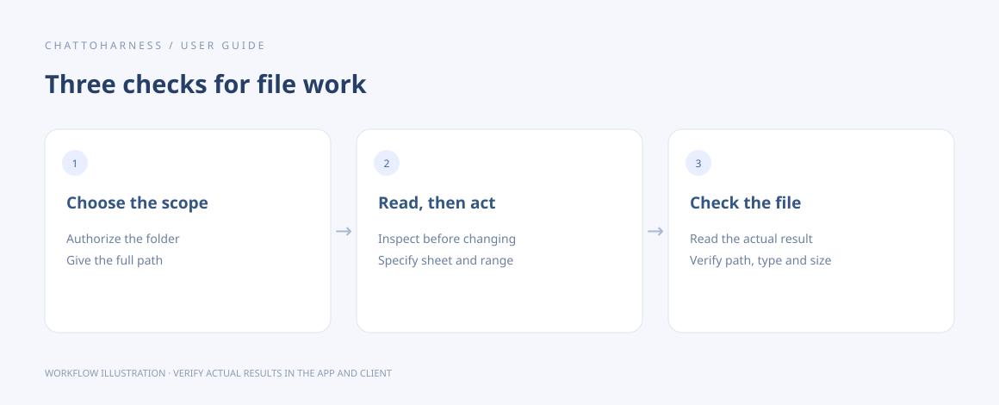

# Find and retrieve task artifacts

[English](../en/artifacts.md) | [简体中文](../zh-CN/artifacts.md) | [日本語](../ja/artifacts.md)

> For ChatToHarness 0.6.0.

## Your goal

Locate files actually produced by a task and inspect readable results.

## Before you start

Know the project and expected output location. File tools can read artifacts only within authorized folders.

## Steps

1. Specify where output files should be saved when starting the task.
2. After it finishes, list the paths, sizes and types of files that actually exist.
3. Read text in sections. Supported small images can be previewed; large files may be returned in parts.
4. Use an actual attachment or file link if your client offers one. Otherwise, open the path in your computer’s file manager.
5. Verify important content and sizes, and keep the final copies you need.

### Example to copy

Replace the example with your own authorized absolute project path; on Windows, use your drive-letter path.

```text
Check the files actually present in /Users/demo/ExampleProject/output. List paths, sizes and types and preview supported images. Do not report nonexistent files as generated.
```



Workflow illustration showing the sequence, not an actual client execution result.

### Paged chat results and on-demand files

Small text results keep their original format. Ordinary tool results over the chat outlet's 16 KiB budget are saved completely and returned as `harness_result_page`. Continue with `get_tool_result_page(result_id, offset=next_offset)`, concatenate each page's `text` in order, then parse the JSON. `sha256` covers the complete JSON's UTF-8 bytes. This budget is not a claimed ChatGPT attachment threshold. Reading pages never reruns the original tool; read all project guidance before retrying a write.

Images, audio and resource blocks initially appear as `$harness_file` references. Use `get_tool_result_file(result_id, file_index)` only when their content is needed. Project artifacts still use `get_file_result` byte pages; native previews require explicit `preview:true`. File delivery may still request client consent. Tools with custom UIs and native resource protocols retain their original formats for compatibility.

Known built-in results may first return `harness_result_summary`; its preview can answer a bounded query without reading every raw page. The full original snapshot and its existing page interface remain available. Guidance marked incomplete must still be read completely before a write.

Complete snapshots live in `result-pages/` under the application's MCP settings directory. They survive reconnects and application restarts without automatic expiry or eviction; deleting these local files invalidates their references. Reads require unchanged source tools, service configurations and authorized folders. Revocation denies access without deleting saved data. Client-only `_meta` is never copied into model-readable pages. If storage fails, the original result is returned with a content-free diagnostic to avoid hiding a completed operation; the size budget cannot be guaranteed in that case.

## What success looks like

You inspect real, accessible files. A filename mentioned in chat does not prove a file or attachment was created.

## If it does not work

For missing files, check task completion, the output path and permissions. A limited response does not mean the file is damaged; read sections or open it locally. Not every client displays a download button.

## Next steps

- [Read documents, images and spreadsheets](reading.md)
- [Start, inspect and cancel background tasks](background-tasks.md)
