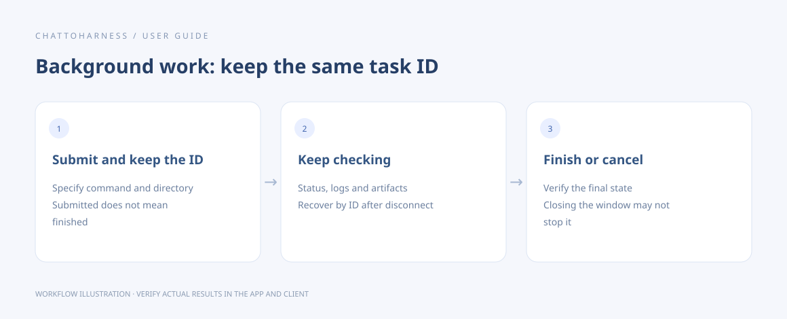

# Start, inspect and cancel background tasks

[English](../en/background-tasks.md) | [简体中文](../zh-CN/background-tasks.md) | [日本語](../ja/background-tasks.md)

> Available in v0.6.2.

## Your goal

Run long work and continue checking the same task after a disconnect.

## Before you start

Identify the project, command and output location. Save important files first. Persistent tasks are normally requested through your client.

## Steps

1. Prefer `start_task` for ordinary non-interactive commands and keep its returned task ID.
2. Short tasks can return their completed result directly. For active tasks, use the returned arguments to query that same task.
3. After completion, inspect the result, exit status and artifacts instead of relying on the last log line.
4. After disconnects, app restarts or client timeouts, query the original task ID before starting anything again.
5. To cancel, identify the task and keep checking until termination or completion is confirmed.

### Example to copy

Replace the example with your own authorized absolute project path; on Windows, use your drive-letter path.

```text
Run my specified command in /Users/demo/ExampleProject as a persistent background task. Keep its task ID and query only that task without starting a duplicate. Report exit status and artifact paths when finished.
```



Workflow illustration showing the sequence, not an actual client execution result.

## What success looks like

You can inspect progress, bounded output and the final state. The project task list can help recover an ID.

## If it does not work

Closing the window, stopping the connection or even quitting the app does not guarantee that persistent tasks stop. Inspect unknown states and artifacts; tasks are not automatically replayed. Concurrency and saved output have limits, so save important artifacts as files.

### Default execution and bounded waits (current source)

Prefer `start_task` for ordinary non-interactive commands and `start_process` for interactive terminals. `start_task.wait_ms` defaults to 2,000 ms; `get_task_result.wait_ms` defaults to 5,000 ms. Both accept 0–10,000; 0 returns immediately. A task finishing within the wait returns its state, exit code and bounded output. Active tasks return their original task ID and next query arguments. Waiting does not change the runtime limit or idempotency identity. Disconnecting or cancelling a query does not cancel the registered task. Terminal starts and output reads wait at most 10 seconds per call and report the effective wait limit.

### Logs and idempotency conflicts

`get_task_logs` pages from the beginning by default. Use `tail:true` without `cursor` for recent entries, without scanning all pages. Use returned cursors unchanged; never calculate offsets from file sizes. Invalid cursors return `INVALID_CURSOR` and safe query arguments. Corrupt saved entries report `TASK_LOG_UNREADABLE`.

Retries with the same key must preserve the command, runtime limit and artifact list. `IDEMPOTENCY_CONFLICT` rejects this request and supplies arguments to inspect the original task; do not automatically switch keys to bypass it. A revised script is a new explicit operation. Nonzero command exits record `TASK_EXIT_NONZERO` and the actual exit code, rather than indicating a connection failure.

## Next steps

- [Find and understand execution history](execution-records.md)
- [Find and retrieve task artifacts](artifacts.md)
- [Handle timeouts, unknown states and missing responses](uncertain-results.md)
