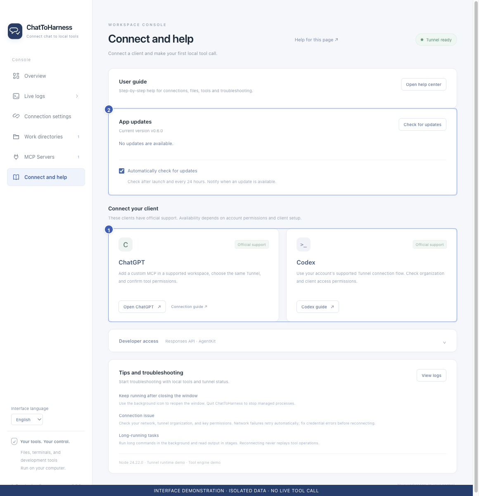

# Connect ChatGPT

[English](../en/chatgpt.md) | [简体中文](../zh-CN/chatgpt.md) | [日本語](../ja/chatgpt.md)

> For ChatToHarness 0.6.0.

## Your goal

Use the tools prepared by your desktop app from ChatGPT.

## Before you start

Make the desktop tunnel ready and ensure your account can add custom MCP connections and use the tunnel.

## Steps

1. Open ChatGPT’s plugin or app management and follow the custom MCP flow available to your account.
2. Under Connection, select Tunnel and choose or enter the same Tunnel ID as in the desktop app.
3. Complete the account or workspace authorization and wait for the tools to appear.
4. Select the plugin in a conversation and run a first read-only check. An existing connection may retain the old name LocalHarness.
5. After updating the app or tools, refresh tools in the plugin details and verify a read-only call.

1 Client connection guidance; 2 App updates. Interface demonstration using the current repository UI and isolated sample data; not evidence of a live tunnel or tool call.

## What success looks like

An actual tool result returns local project information. Seeing a tunnel, discovering tools and successfully calling them are separate steps.

## If it does not work

If the option or tunnel is missing, ask the administrator to check workspace association and access. ChatGPT confirmations are separate from local permissions; review the request and follow the prompt. See the official setup link below.

[Official OpenAI setup guide](https://developers.openai.com/api/docs/guides/custom-mcp-server)

## Next steps

- [Complete your first task](first-task.md)
- [Find a missing tunnel or tool in your client](missing-tools.md)
- [Manage tool permissions and local approval](tool-permissions.md)
