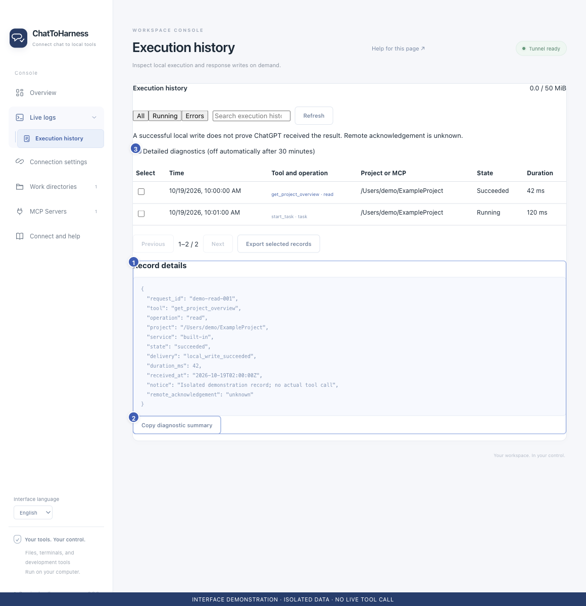

# Collect diagnostics, copy details and export records

[English](../en/diagnostics.md) | [简体中文](../zh-CN/diagnostics.md) | [日本語](../ja/diagnostics.md)

> For ChatToHarness 0.6.0.

## Your goal

Gather evidence for a specific issue and review it before sharing.

## Before you start

Prepare reproduction steps and first check whether ordinary records explain the problem.

## Steps

1. Enable Detailed diagnostics in Execution history if more detail is needed. It turns off after 30 minutes and can be disabled earlier.
2. Reproduce the issue once and note its time and request ID. Avoid repeating operations that modify data.
3. Open the relevant record and use Copy diagnostic summary.
4. Select the relevant records and choose Export selected records to save a JSON file. At most 100 records can be selected at once.
5. Inspect the export and remove private paths, content, arguments or other sensitive data before attaching it to an issue.

1 Record details; 2 Copy diagnostic summary; 3 Detailed diagnostics. Interface demonstration using the current repository UI and isolated sample data; not evidence of a live tunnel or tool call.

## What success looks like

You have selected records and a timeline for the issue. This export is not a complete settings or conversation backup.

## If it does not work

Logs and details can contain user data; redaction is not guaranteed. Cleanable logs share a 50 MiB budget. Execution history are kept for up to seven days or 10,000 entries; save important evidence promptly.

## Next steps

- [Understand access, credentials and local records](privacy.md)
- [Common questions and getting help](faq.md)
- [Find and understand execution history](execution-records.md)
