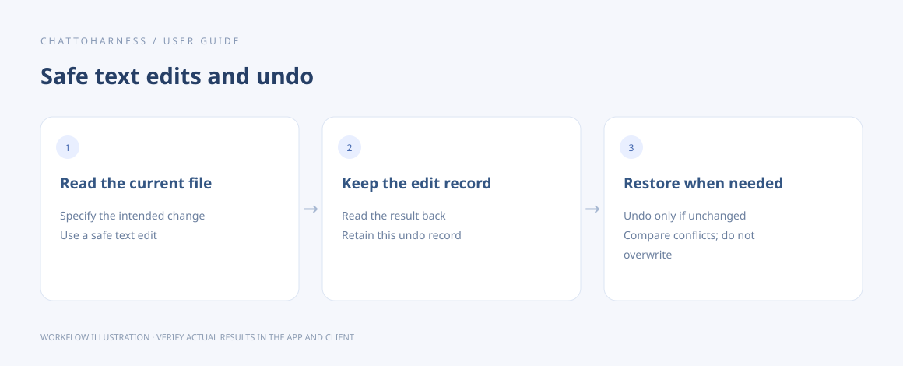

# Edit files and undo safe text changes

[English](../en/editing.md) | [简体中文](../zh-CN/editing.md) | [日本語](../ja/editing.md)

> For ChatToHarness 0.6.0.

## Your goal

Make a specific change and retain an undo record when supported.

## Before you start

Read the current content first and back up important material. Safe text edits support regular UTF-8 files up to 1 MiB.

## Steps

1. Identify the file, desired change and content to preserve; ask the client to read the current version first.
2. For text, request a safe edit and keep its undo record. Before creating a file, check that the path is new.
3. Read the result back and verify the intended changes.
4. To undo, identify that particular safe edit and ask the client to use its undo record.
5. Use format-specific tools for Word, Excel and PDF. Those changes do not automatically receive safe-text undo.

### Example to copy

Replace the example with your own authorized absolute project path; on Windows, use your drive-letter path.

```text
Read /Users/demo/ExampleProject/notes.txt, change the title “Draft” to “Meeting notes” using a safe text edit, keep the undo record, and read the result back.
```



Workflow illustration showing the sequence, not an actual client execution result.

Specify whether text should be newly written, appended or replaced in a limited location. For a Word paragraph or spreadsheet cells, identify the exact paragraph or sheet and range and read back the result.

## What success looks like

A successful safe edit returns an undo record. Successful undo restores the content from before that edit.

## If it does not work

If you or another app changed the file afterward, undo refuses to overwrite it. Compare the current version before repairing it. Commands, file moves and arbitrary edits are not universally reversible; concurrent external writes are not fully protected.

## Next steps

- [Read documents, images and spreadsheets](reading.md)
- [Handle timeouts, unknown states and missing responses](uncertain-results.md)
