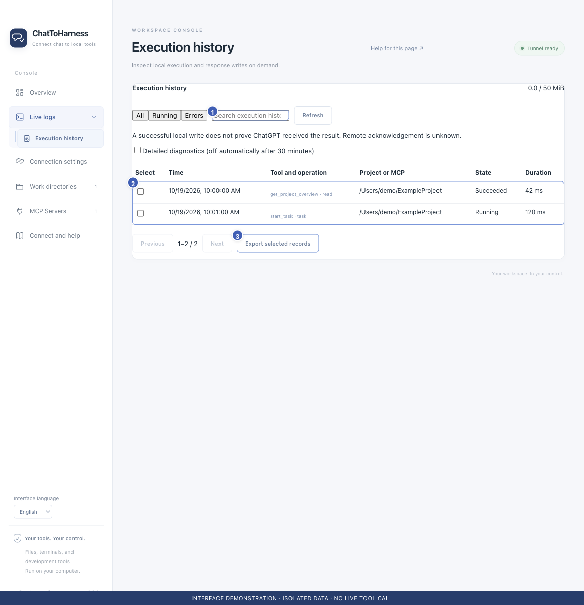

# Find and understand execution history

[English](../en/execution-records.md) | [简体中文](../zh-CN/execution-records.md) | [日本語](../ja/execution-records.md)

> For ChatToHarness 0.6.0.

## Your goal

Check what happened locally before continuing or retrying a request.

## Before you start

Expand Live logs in the sidebar or use its execution-record shortcut.

## Steps

1. Open Execution history and choose All, Running or Errors.
2. Search by tool name, request ID or project; refresh and page through results when needed.
3. Select a record’s Tool and operation entry to open details.
4. Check time, project or service, execution state, duration and any linked task.
5. Distinguish local execution success, response written to the local channel and actual receipt by the client.
6. If a task ID exists, inspect that task instead of starting another.

From chat, call `get_execution_summary` directly with the authorized `project_path` and `state:"errors"` for recent failures. It returns request IDs, tool names, states, durations, error reasons and any task ID, without raw arguments or output. The default is 10 records, at most 50; use `tool`, `since` and the returned cursor to narrow or page the result.

1 Search; 2 Execution list; 3 Export selected records. Interface demonstration using the current repository UI and isolated sample data; not evidence of a live tunnel or tool call.

## What success looks like

You can associate a client operation with its local record and see how far it was confirmed. Without a client acknowledgement, remote receipt may remain unknown.

## If it does not work

A missing record does not prove nothing ran; retention or filters may hide it. Clear filters and check time and target. For an uncertain write, inspect the actual file or external app before retrying.

## Next steps

- [Handle timeouts, unknown states and missing responses](uncertain-results.md)
- [Collect diagnostics, copy details and export records](diagnostics.md)
- [Start, inspect and cancel background tasks](background-tasks.md)
