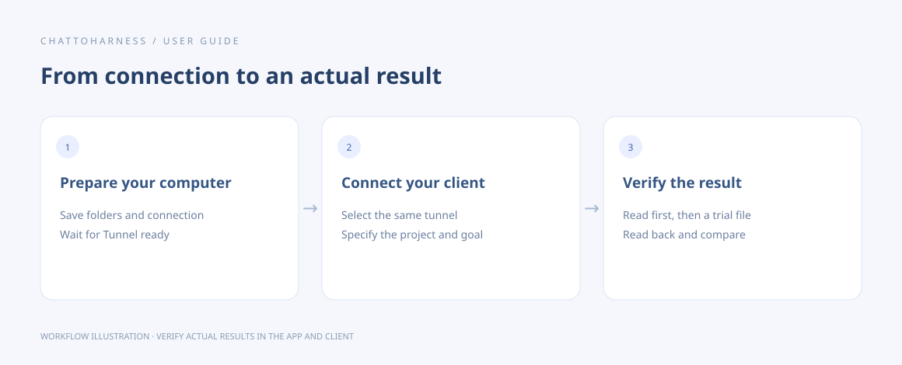

# Common questions and getting help

[English](../en/faq.md) | [简体中文](../zh-CN/faq.md) | [日本語](../ja/faq.md)

> For ChatToHarness 0.6.0.

## Your goal

Explain common behavior and prepare a useful issue report.

## Before you start

Note your app version, operating system and approximate incident time.

## Steps

1. Can I use a phone? A supported chat client can request remote work, but the computer and desktop app must remain running.
2. Does closing the window stop work? No. Stop and quit are separate, and persistent tasks need explicit cancellation.
3. Why more confirmations? The app, client, operating system and external service have independent permissions.
4. Do I need a development environment? Runtime components are bundled; external tools can have separate requirements.
5. For support, open an issue in the official repository with system, version, steps, expected versus actual results and reviewed records.
6. Search existing issues first and attach a minimal example without keys or a complete private project.

Workflow illustration showing the sequence, not an actual client execution result.

For additional tool diagnostics, ask the client to summarize recent calls, usage and current tool settings. Review the effect before changing a tool setting; folder authorization must still be changed in the desktop app. The bundled Desktop Commander feedback action opens that component’s own form, separate from ChatToHarness repository issues.

## What success looks like

Your report explains how to reproduce the issue and which stage failed.

## If it does not work

Mark unverified clients, systems or external tools as unverified. Platform permissions belong to the relevant service; a repository issue cannot replace administrator approval.

[GitHub Issues](https://github.com/DJ-Huang/ChatToHarness/issues)

## Next steps

- [Collect diagnostics, copy details and export records](diagnostics.md)
- [Before you begin](requirements.md)
- [Start, inspect and cancel background tasks](background-tasks.md)
