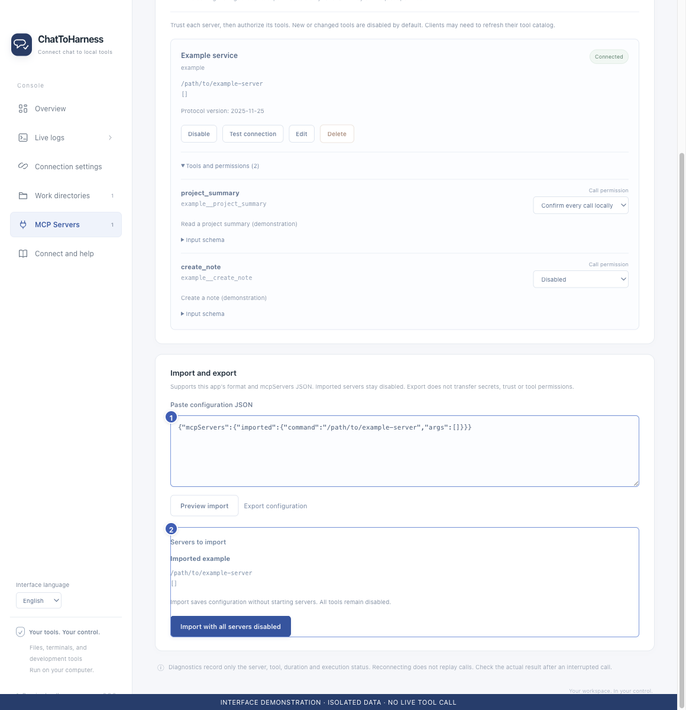

# Import and export tool configurations

[English](../en/import-export.md) | [简体中文](../zh-CN/import-export.md) | [日本語](../ja/import-export.md)

> For ChatToHarness 0.6.0.

## Your goal

Reuse service settings and set up credentials and permissions on the destination computer.

## Before you start

Use trusted configuration sources. Launch paths may need adjustment for the destination.

## Steps

1. Paste an app export or a common mcpServers configuration into Import and export on MCP Servers.
2. Choose Preview import and inspect services, commands, endpoints and missing items. Preview does not launch services.
3. Choose Confirm import with all services disabled after review.
4. On the destination, fill required keys and paths, review trust, authorize tools and connect.
5. For export, choose Export configuration, copy the result and store it appropriately.

1 Paste trusted configuration; 2 Review and confirm; imports stay disabled. Interface demonstration using the current repository UI and isolated sample data; not evidence of a live tunnel or tool call.

After export, use Copy configuration to retain a local copy; this is separate from exporting selected execution records.

## What success looks like

Imported services stay disabled. Exports omit key values, trust records and tool permissions, so they are not a complete account backup.

## If it does not work

Repeat preview if it expires or conflicts with current settings. Do not run unfamiliar commands. Between Mac and Windows, check paths and platform overrides. Exports do not include the tunnel key, work directories or all preferences.

## Next steps

- [Add a local MCP service](local-services.md)
- [Manage tool permissions and local approval](tool-permissions.md)
- [Replace or clear connection credentials](credentials.md)
