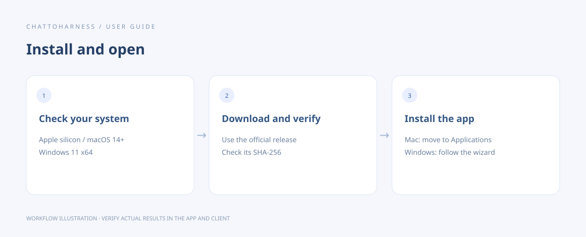

# Fix installation or launch problems

[English](../en/installation-problems.md) | [简体中文](../zh-CN/installation-problems.md) | [日本語](../ja/installation-problems.md)

> For ChatToHarness 0.6.0.

## Your goal

Identify problems using the download source, system requirements and exact warning.

## Before you start

Keep the filename and operating-system warning. Do not delete existing settings first.

## Steps

1. Check the platform: Apple silicon with macOS 14+, or Windows 11 x64.
2. Verify the installer came from the official GitHub release and matches its filename and SHA-256 checksum.
3. On Mac, move the app into Applications. For a notarization warning, verify the source before using system security controls.
4. On Windows, check the release’s unsigned-installer notes and file integrity before responding to reputation warnings.
5. If bundled components are unavailable, download the matching installer again and preserve the error for support.

Workflow illustration showing the sequence, not an actual client execution result.

## What success looks like

You either open the console or identify a specific blocker after verifying source and compatibility.

## If it does not work

Do not disable system-wide protection to bypass one warning. Before assuming the app failed to launch, check its tray icon for a hidden window. Reinstallation does not require deleting personal data first.

## Next steps

- [Install ChatToHarness](installation.md)
- [Common questions and getting help](faq.md)
