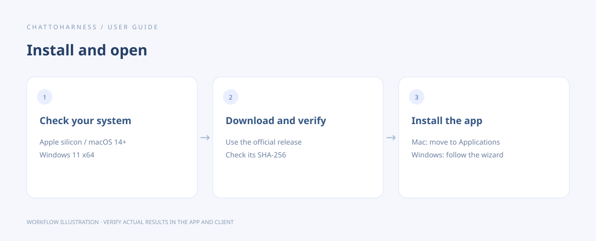

# Install ChatToHarness

[English](../en/installation.md) | [简体中文](../zh-CN/installation.md) | [日本語](../ja/installation.md)

> The installer examples and signing notes below refer to the public [v0.8.1 release](https://github.com/DJ-Huang/ChatToHarness/releases/tag/v0.8.1). For another version, use its own filenames, checksum file and release notes.

## Your goal

Install the official release for your computer and open the console.

## Before you start

Check the system and account requirements, then open GitHub Releases from the website.

## Steps

1. Download the installer for your system from the official release: the Apple silicon .dmg for Mac or the x64 -setup.exe for Windows.
2. Download SHA256SUMS.txt from the same release. Before opening the installer, follow the checksum steps below and read that release's signing notes.
3. After verification, install the app. Mac: open the .dmg and drag the app to Applications. Windows: run the -setup.exe and follow the installation wizard.
4. Open the app and look for Overview, Connection and Work directories in the sidebar.

### Check the download before opening it

These read-only examples assume both files are in your Downloads folder and retain their original names. Replace the paths if you saved them elsewhere or the browser renamed a duplicate download. Use the installer and SHA256SUMS.txt from the same release; do not use the repository's source-code ZIP as the installer.

On Mac, open Terminal and run:

```sh
shasum -a 256 "$HOME/Downloads/ChatToHarness-0.8.1-macos-arm64.dmg"
cat "$HOME/Downloads/SHA256SUMS.txt"
```

On Windows, open PowerShell and run:

```powershell
(Get-FileHash -Algorithm SHA256 -LiteralPath "$HOME\Downloads\ChatToHarness-0.8.1-windows-x64-setup.exe").Hash
Get-Content -LiteralPath "$HOME\Downloads\SHA256SUMS.txt"
```

The first command prints the downloaded file's SHA-256. Compare that 64-character value with the line for the **same installer filename** in SHA256SUMS.txt, ignoring letter case. The file lists both platforms; you only need to check the installer you downloaded. The entire value must match before you continue.

If the file is missing, correct the path. If the values differ, do not open the installer: check the filename and release, then download the installer and checksum file again from the official Release. A matching checksum confirms that the bytes match the published checksum; it does not replace code signing or notarization and does not by itself prove that software is safe. Keep system protection enabled.



Workflow illustration showing the sequence, not an actual client execution result.

## What success looks like

The console opens. Installation alone does not establish a tunnel; connection details come next.

## If it does not work

The v0.8.1 Mac app is ad-hoc signed and not notarized; the Windows installer is unsigned. The operating system may warn or block installation. Verify the source, checksum and release notes before deciding whether to continue. Do not disable system-wide protection or use an installer for a different architecture.

[GitHub Releases](https://github.com/DJ-Huang/ChatToHarness/releases)

## Next steps

- [Make your first connection](first-connection.md)
- [Fix installation or launch problems](installation-problems.md)
