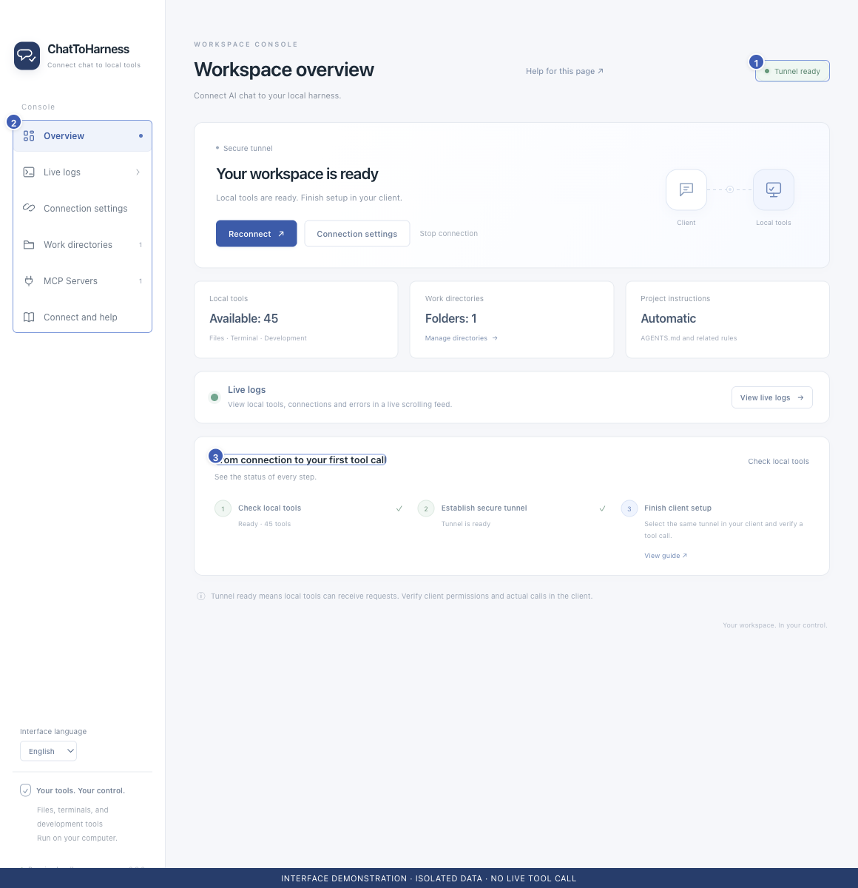

# What ChatToHarness can do

[English](../en/introduction.md) | [简体中文](../zh-CN/introduction.md) | [日本語](../ja/introduction.md)

> For ChatToHarness 0.6.0.

## Your goal

Work with files and tasks on your computer from an AI conversation.

## Before you start

Use a supported computer and a ChatGPT or Codex account with access to Tunnel connections.

## Steps

1. Run ChatToHarness on your computer to manage connections, folders and tools.
2. Describe your task in the client and identify the folder to work in.
3. Connect external tool services when needed, choosing their permissions locally.
4. Return to the app to inspect connection status, live logs and execution history.

1 Connection state; 2 Feature navigation; 3 First-call checklist. Interface demonstration using the current repository UI and isolated sample data; not evidence of a live tunnel or tool call.

## What success looks like

Files and commands are handled on the computer running ChatToHarness. Results return through your client. Available tools depend on your configuration.

## If it does not work

A supported mobile chat client can be an entry point, but the host computer must stay awake with the app running. The app does not include general mouse-and-keyboard automation. External capabilities depend on each service.

## Next steps

- [Before you begin](requirements.md)
- [Make your first connection](first-connection.md)
