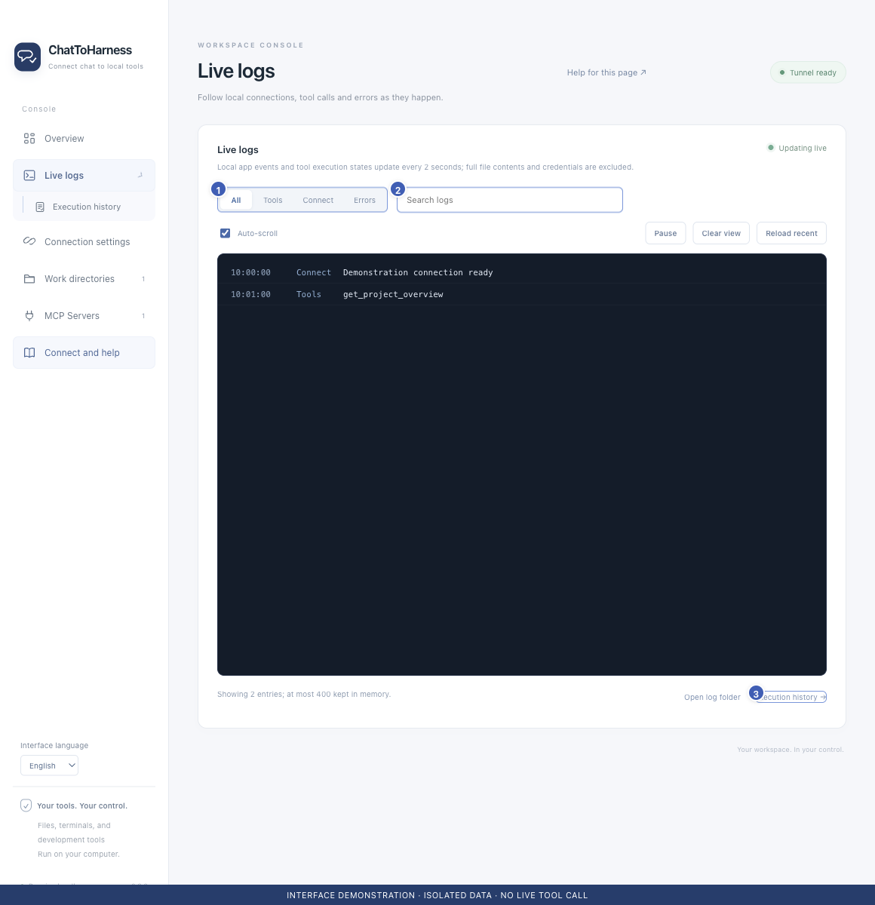

# View and filter live logs

[English](../en/live-logs.md) | [简体中文](../zh-CN/live-logs.md) | [日本語](../ja/live-logs.md)

> For ChatToHarness 0.6.0.

## Your goal

Follow connection and tool events in a continuously updating view.

## Before you start

Generate some app activity first. Logs show recent events, not the complete conversation.

## Steps

1. Open Live logs from the sidebar or Overview shortcut.
2. Filter by All, Tools, Connection or Errors according to the issue.
3. Search for a tool name, request ID or keyword; clear the search and try another category if needed.
4. Pause to read, then resume. Turn off automatic scrolling when useful.
5. Reload refreshes the recent view. Clear display clears the screen without deleting disk logs.
6. Use the bottom links to open the log folder or inspect execution history.

1 Category filters; 2 Search; 3 Execution-record shortcut. Interface demonstration using the current repository UI and isolated sample data; not evidence of a live tunnel or tool call.

## What success looks like

The view updates about every two seconds. Pausing the display does not pause tool execution.

## If it does not work

This bounded recent view may skip intermediate events during heavy activity and is not a complete audit stream. Requests awaiting instructions or missing arguments may appear under All or Tools rather than Errors.

## Next steps

- [Find and understand execution history](execution-records.md)
- [Collect diagnostics, copy details and export records](diagnostics.md)
