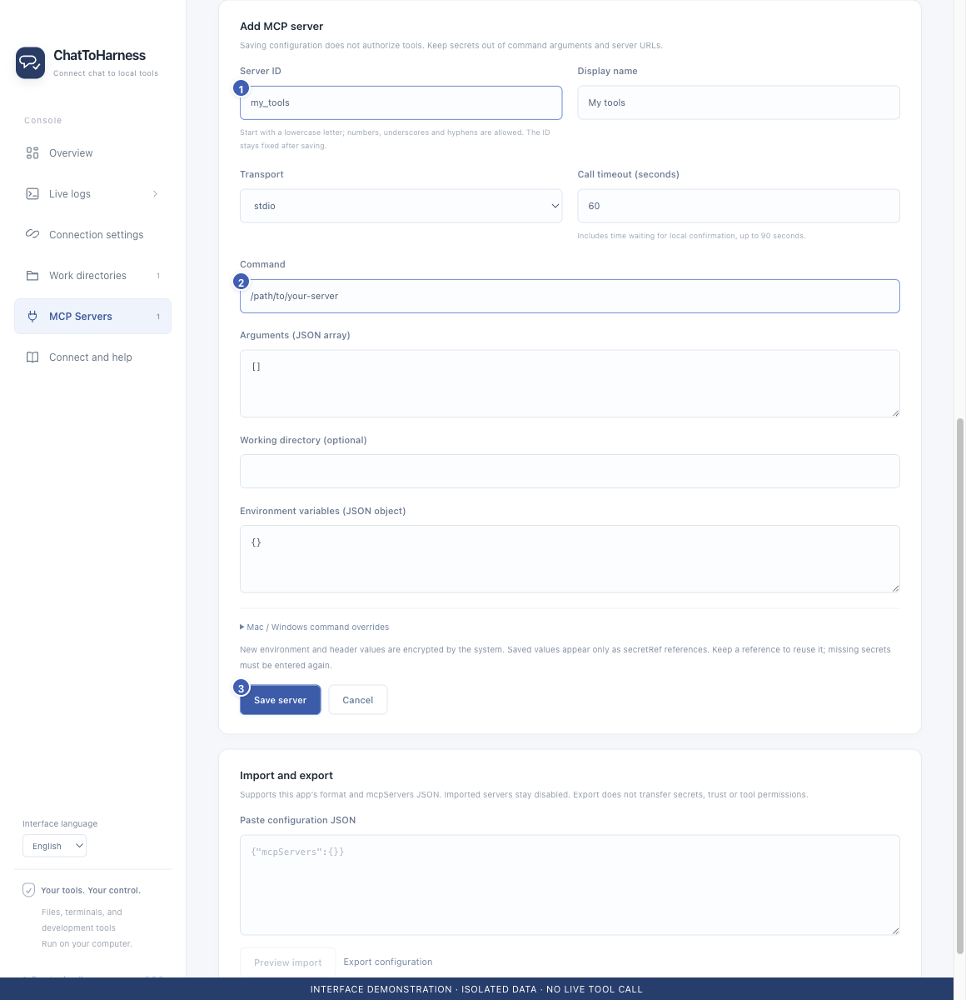

# Add a local MCP service

[English](../en/local-services.md) | [简体中文](../zh-CN/local-services.md) | [日本語](../ja/local-services.md)

> For ChatToHarness 0.6.0.

## Your goal

Connect an external tool installed on your computer.

## Before you start

Install the service using its official guide and obtain its launch command, arguments and required keys. The app does not install every external tool for you.

## Steps

1. Open MCP Servers and choose Add server.
2. Enter a stable service ID and display name. The ID cannot change after saving; my_tools is an example.
3. Choose stdio and copy the command and arguments from the service guide. Use [] for no arguments and a separate string for each argument.
4. Fill an optional working directory and environment variables. Put keys in the dedicated fields, not command arguments.
5. Use Mac / Windows launch overrides for different paths when necessary. The call limit includes local-confirmation waiting time.
6. Save, review trust, test the connection and authorize tools individually.

1 Stable service ID; 2 Vendor launch command; 3 Save configuration. Interface demonstration using the current repository UI and isolated sample data; not evidence of a live tunnel or tool call.

## What success looks like

The service appears in the list. Saving alone does not authorize tools or prove that it connected.

## If it does not work

If the command cannot be found, check installation and its absolute path. Keep arguments with spaces as individual entries. Services run as your user and are not confined by the folder allowlist. The screenshot command is an example, not an installable service.

## Next steps

- [Trust a service and test its connection](service-trust.md)
- [Manage tool permissions and local approval](tool-permissions.md)
- [Import and export tool configurations](import-export.md)
