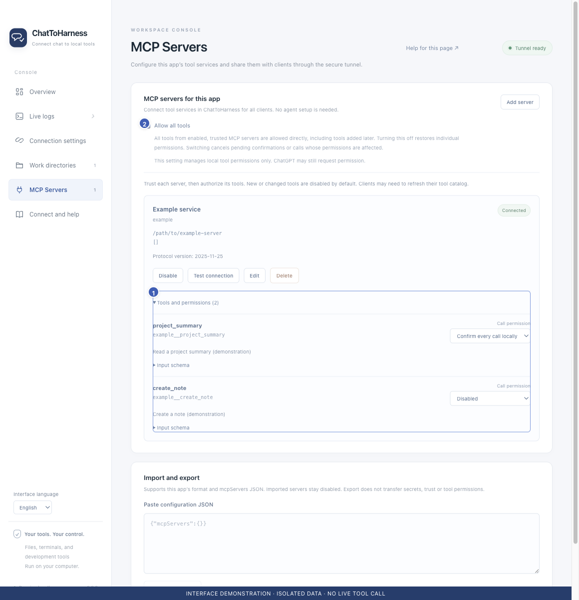

# Edit, enable, disable and remove services

[English](../en/manage-services.md) | [简体中文](../zh-CN/manage-services.md) | [日本語](../ja/manage-services.md)

> These steps describe the plugin interface in [ChatToHarness v0.8.1](https://github.com/DJ-Huang/ChatToHarness/releases/tag/v0.8.1).

## Your goal

Maintain external connections and distinguish one service from the whole tunnel.

## Before you start

Inspect in-progress work first; wait for its result or explicitly cancel when needed.

## Steps

1. Open **Plugins**, find the external MCP service and choose **Manage** on its card. The management panel opens on the right.
2. Review its status and tools under **Overview & permissions**. To change configuration, select **Connection settings** (or Edit in the overview). The service ID stays fixed; changed launch targets require renewed trust.
3. Under **Overview & permissions**, Disable stops only that service. Enable it again when needed and check its state.
4. To remove one, choose Delete in the same overview, then Confirm deletion after review. This stops it and removes its configuration.
5. Refresh the client’s tools after changes and verify with a read-only call.

1 Tools and individual policies; 2 Optional all-tools permission. Earlier interface demonstration with isolated sample data. For v0.8.1 menu and panel locations, follow the steps above; this image is not evidence of a live tunnel or tool call.

## What success looks like

The service state and available tool catalog reflect current enablement and permissions. Clients using the same tunnel share these settings.

## If it does not work

Stop connection stops the tunnel and all managed services; closing the window does not. Transport faults reconnect independently without replaying operations. Deleting configuration does not uninstall third-party software.

## Next steps

- [Import and export tool configurations](import-export.md)
- [Find a missing tunnel or tool in your client](missing-tools.md)
