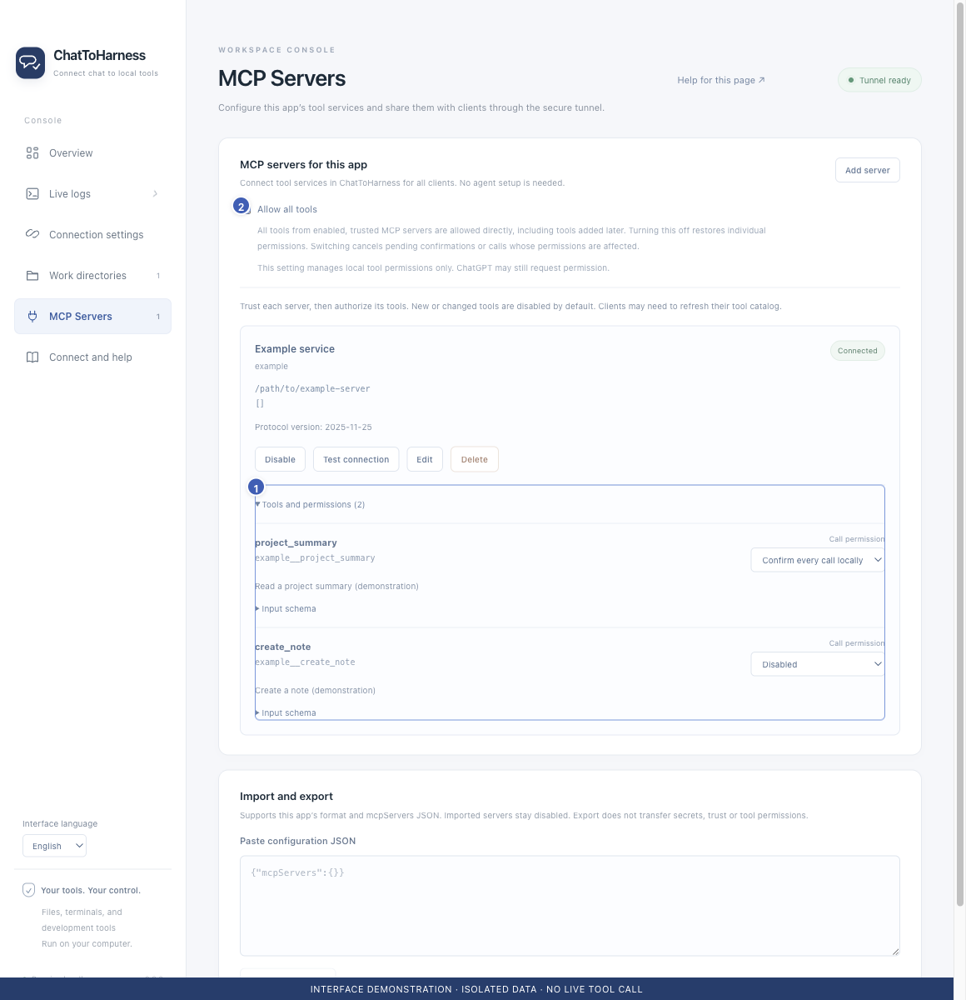

# Find a missing tunnel or tool in your client

[English](../en/missing-tools.md) | [简体中文](../zh-CN/missing-tools.md) | [日本語](../ja/missing-tools.md)

> For ChatToHarness 0.6.0.

## Your goal

Check the app, account and catalog to locate the missing connection.

## Before you start

Keep the desktop app running and identify whether you need a built-in file tool or an external service.

## Steps

1. Missing tunnel: check association with the intended ChatGPT workspace and Platform organization and verify user access.
2. Desktop not ready: resolve the connection error in Overview first.
3. Missing built-in file tools: add and save at least one authorized work directory.
4. Missing external tool: enable and trust the service, connect it successfully and ensure the tool is not disabled.
5. Refresh tools in the client’s plugin details, select the right plugin and try a read-only call. Existing plugins may still be named LocalHarness.

1 Tools and individual policies; 2 Optional all-tools permission. Interface demonstration using the current repository UI and isolated sample data; not evidence of a live tunnel or tool call.

## What success looks like

The client discovers the authorized catalog and makes an actual call. External tool names normally carry a service ID prefix.

## If it does not work

An app-side available-tool count does not prove this conversation refreshed its catalog. For clients without a resource browser, use read-only resource queries. A service cannot expose capabilities it does not provide.

## Next steps

- [Connect ChatGPT](chatgpt.md)
- [Connect Codex](codex.md)
- [Manage tool permissions and local approval](tool-permissions.md)
