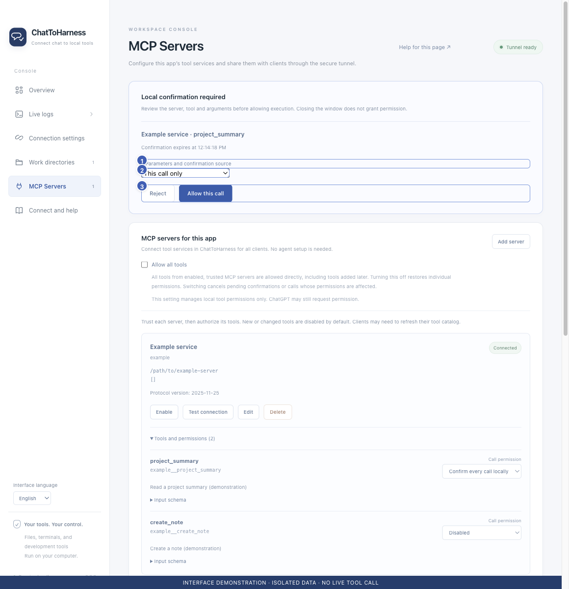

# Resolve folder, credential or tool permission errors

[English](../en/permission-problems.md) | [简体中文](../zh-CN/permission-problems.md) | [日本語](../ja/permission-problems.md)

> For ChatToHarness 0.6.0.

## Your goal

Identify which permission layer blocked an operation and fix it in the right place.

## Before you start

Keep the exact error and distinguish app, operating-system, service and client approvals.

## Steps

1. Folder denied: add the target in Work directories, save and check the absolute path and resolved link target.
2. Saved key unreadable: handle the system authorization prompt or re-enter the key in the app.
3. External authentication failed: check that service’s environment or header credentials.
4. Tool disabled or untrusted: review its source in MCP Servers, establish trust and set its policy.
5. Local approval expired: check whether execution started before sending a new reviewed request and approving it promptly.
6. ChatGPT still asks: review the independent client confirmation there.

1 Inspect arguments; 2 Remembered scope; 3 Deny or allow. Interface demonstration using the current repository UI and isolated sample data; not evidence of a live tunnel or tool call.

## What success looks like

Adjust only the relevant permission and verify using a suitable read-only call.

## If it does not work

Calls without an applicable project may not offer remembered project approval. Configuration or tool changes may require fresh permission. Do not use chat tools to change the folder allowlist or expose all personal folders to solve one failure.

## Next steps

- [Manage work directories and project instructions](work-directories.md)
- [Manage tool permissions and local approval](tool-permissions.md)
- [Replace or clear connection credentials](credentials.md)
