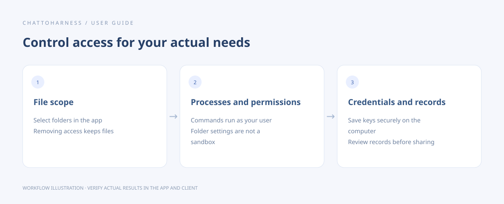

# Understand access, credentials and local records

[English](../en/privacy.md) | [简体中文](../zh-CN/privacy.md) | [日本語](../ja/privacy.md)

> For ChatToHarness 0.6.0.

## Your goal

Know what is stored locally and which access scopes you must manage.

## Before you start

Distinguish file tools, terminals, external services and the connected AI client.

## Steps

1. File tools: manage access with Work directories; removing authorization does not delete files.
2. Terminals and external processes: run with your user permissions and are not sandboxed by the folder allowlist.
3. Credentials: tunnel and service keys use system encryption and are not revealed after saving; configuration exports retain references only.
4. Records: diagnostics, execution details and task output have retention limits and may contain project content or paths. Review before sharing.
5. Results: the client receives relevant tool output. Each provider’s own policies govern its processing.
6. Reduce access by removing folders, disabling tools or services and stopping the connection locally. Cancel persistent tasks separately.

Workflow illustration showing the sequence, not an actual client execution result.

## What success looks like

You can control access for your actual needs and distinguish local records from results received by the client.

## If it does not work

No visible log does not mean no data exists, and redaction cannot guarantee every credential is removed. Keep keys out of command output, arguments and screenshots. Removing a service does not uninstall software or erase all historical records.

## Next steps

- [Manage work directories and project instructions](work-directories.md)
- [Manage tool permissions and local approval](tool-permissions.md)
- [Collect diagnostics, copy details and export records](diagnostics.md)
