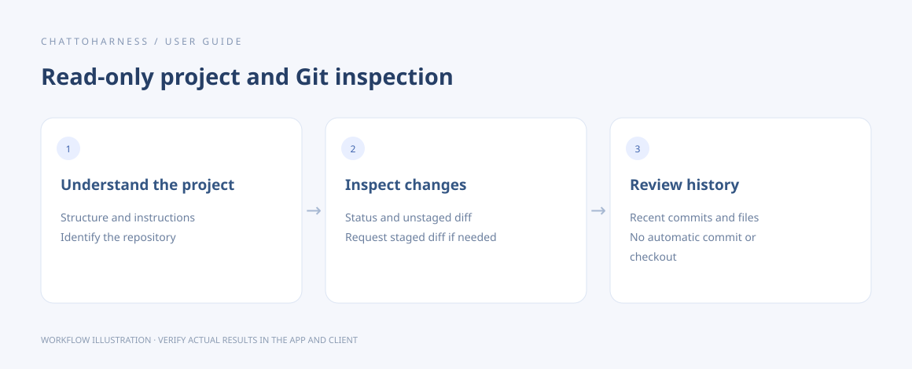

# Understand a project and inspect Git changes

[English](../en/project-git.md) | [简体中文](../zh-CN/project-git.md) | [日本語](../ja/project-git.md)

> For ChatToHarness 0.6.0.

## Your goal

Explore a project and read its changes and commit history.

## Before you start

Authorize the project folder. Git queries require Git on the computer and a project that is a Git repository.

## Steps

1. Request a project overview to see its structure, current state and available instructions.
2. Inspect Git status, distinguishing staged, unstaged and untracked files.
3. Choose the diff scope: unstaged changes are the default; explicitly request staged changes or specific files when needed.
4. Read recent commits, specifying a count and any files of interest.
5. Tie the summary to actual files and request additional pages if necessary.

### Example to copy

Replace the example with your own authorized absolute project path; on Windows, use your drive-letter path.

```text
Show the project overview, Git status and unstaged diff for /Users/demo/ExampleProject. Summarize the changes without committing or editing.
```



Workflow illustration showing the sequence, not an actual client execution result.

## What success looks like

The result describes the actual project, changes and history. These read-only queries do not commit, change branches or edit files.

## If it does not work

If Git is unavailable or the folder is not a repository, report the cause; ordinary file reading can continue. Note partial results and expired pages. Viewing a diff does not commit the changes.

## Next steps

- [Search filenames and content](search.md)
- [Read documents, images and spreadsheets](reading.md)
