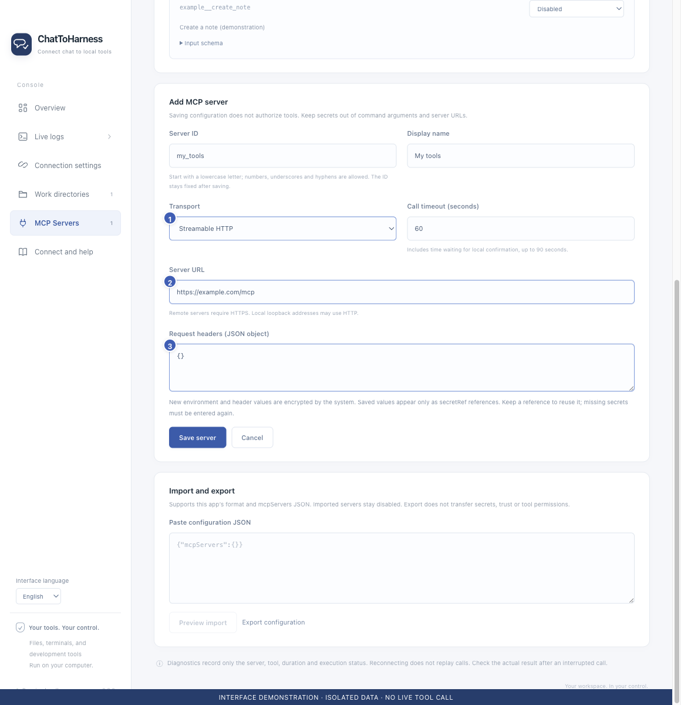

# Add a remote MCP service

[English](../en/remote-services.md) | [简体中文](../zh-CN/remote-services.md) | [日本語](../ja/remote-services.md)

> For ChatToHarness 0.6.0.

## Your goal

Connect a remote tool endpoint provided by a service vendor.

## Before you start

Obtain the vendor’s Streamable HTTP MCP endpoint and authentication requirements.

## Steps

1. Add a service in MCP Servers and enter its ID and display name.
2. Choose Streamable HTTP and enter the endpoint. Remote endpoints require HTTPS; HTTP is allowed only for local loopback addresses.
3. Enter the headers required by the vendor, such as authentication. Save them locally rather than placing keys in the URL or chat.
4. Confirm that the service supports static credentials. This version does not support OAuth sign-in or legacy HTTP+SSE.
5. Save, review the endpoint, test the connection and authorize tools.

1 Transport choice; 2 Remote endpoint; 3 Authentication headers. Interface demonstration using the current repository UI and isolated sample data; not evidence of a live tunnel or tool call.

## What success looks like

The service is listed and a successful connection test lets you inspect its actual tools.

## If it does not work

A website loading in a browser does not establish that it is an MCP endpoint. For authentication errors, check the required key and headers. Do not use the desktop tunnel ID or runtime key as third-party service credentials.

## Next steps

- [Trust a service and test its connection](service-trust.md)
- [Manage tool permissions and local approval](tool-permissions.md)
