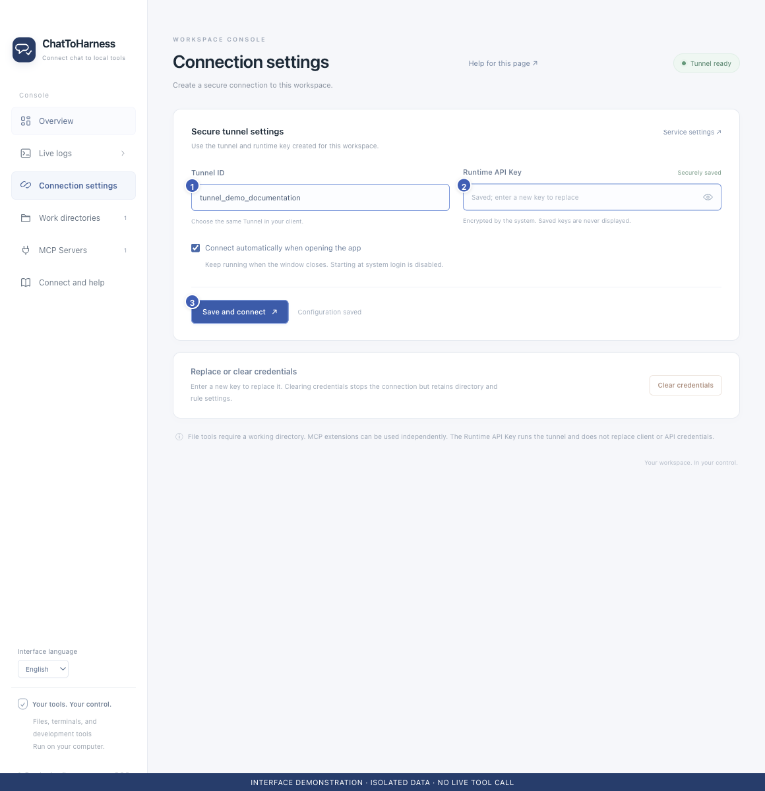

# Before you begin

[English](../en/requirements.md) | [简体中文](../zh-CN/requirements.md) | [日本語](../ja/requirements.md)

> For ChatToHarness 0.6.0.

## Your goal

Check your computer, account and connection details before installing.

## Before you start

Use an Apple silicon Mac running macOS 14 or later, or a Windows 11 x64 computer.

## Steps

1. Confirm that your account offers a Tunnel connection option; ask your workspace administrator if it does not.
2. Create or select a tunnel in OpenAI Platform Tunnels, associating the intended organization and ChatGPT workspace.
3. Creating or editing requires Tunnels Read + Manage; running and using a tunnel requires Read + Use.
4. Prepare the Tunnel ID, Runtime API Key and an empty folder for your first trial.

1 Tunnel ID; 2 Local runtime key; 3 Save and connect. Interface demonstration using the current repository UI and isolated sample data; not evidence of a live tunnel or tool call.

## What success looks like

You can access the tunnel settings and know which tunnel and permissions to use. The installer includes the runtime components; no separate development environment is needed.

## If it does not work

Installing the app does not grant account permissions. Enter the Runtime API Key only in the desktop app, never in chat. External tools may require their own installation or account.

[Official OpenAI setup guide](https://developers.openai.com/api/docs/guides/secure-mcp-tunnels#permissions-and-access)

## Next steps

- [Install ChatToHarness](installation.md)
- [Connect ChatGPT](chatgpt.md)
