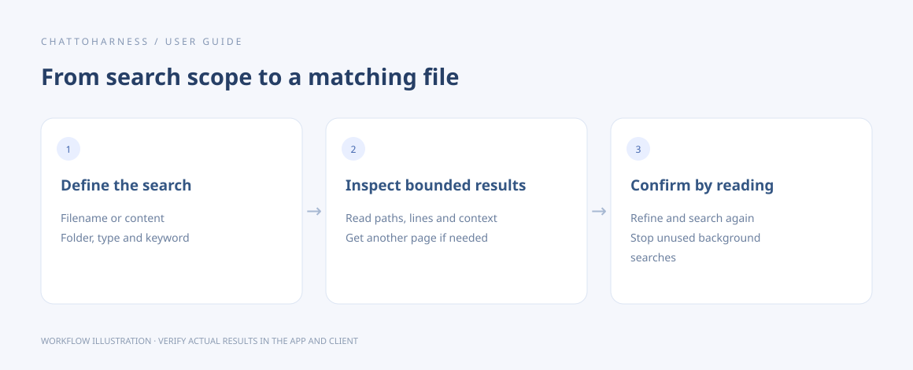

# Search filenames and content

[English](../en/search.md) | [简体中文](../zh-CN/search.md) | [日本語](../ja/search.md)

> For ChatToHarness 0.6.0.

## Your goal

Find a filename or the places where a keyword appears in a folder.

## Before you start

Authorize the folder and prepare a keyword and approximate scope.

## Steps

1. Specify the project and whether you are searching filenames or file contents.
2. Add file types, subfolders or exclusions. Content search uses ordinary text by default; explicitly request pattern matching when needed.
3. For many matches, inspect the first page, line numbers and nearby text before requesting more.
4. Stop a background search when it is no longer needed; you can also ask which searches are active.
5. Refine the query or scope and read matching files to confirm.

### Example to copy

Replace the example with your own authorized absolute project path; on Windows, use your drive-letter path.

```text
Search Markdown files in /Users/demo/ExampleProject for “release plan”. Show paths, line numbers and nearby text without modifying files.
```



Workflow illustration showing the sequence, not an actual client execution result.

## What success looks like

Filename results identify paths; content results include paths, line numbers and nearby text. Results distinguish no matches from partial output.

## If it does not work

Search has time and result limits. A partial result is not proof of an exhaustive scan. Ignored folders and binary files are skipped by default. If an old results page expires, repeat the search.

## Next steps

- [Read documents, images and spreadsheets](reading.md)
- [Browse and organize files](files.md)
