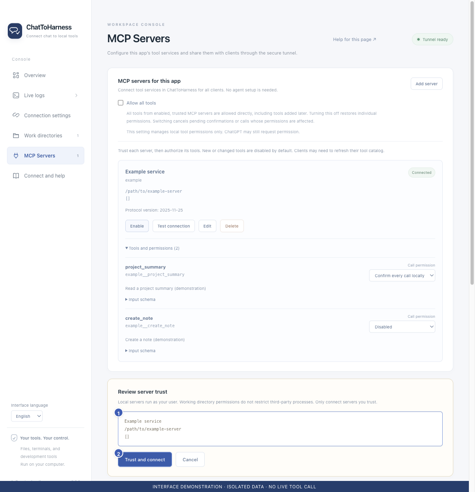

# Trust a service and test its connection

[English](../en/service-trust.md) | [简体中文](../zh-CN/service-trust.md) | [日本語](../ja/service-trust.md)

> For ChatToHarness 0.6.0.

## Your goal

Review the actual launch target before enabling an external service.

## Before you start

Save the configuration and establish that its source is trustworthy.

## Steps

1. Choose Test connection or Enable on the service card.
2. In the trust review, check the service name, actual command and arguments or remote endpoint. Cancel and consult the vendor guide if uncertain.
3. Choose Trust and test or Trust and connect once reviewed.
4. Check its state and tool preview, then grant the minimum useful permissions.
5. Review trust again after changing the launch target.

1 Actual connection target; 2 Confirm trust. Interface demonstration using the current repository UI and isolated sample data; not evidence of a live tunnel or tool call.

## What success looks like

The test checks connectivity and tool discovery without invoking the discovered business tools. A healthy connection is reused.

## If it does not work

Trust and tool authorization are separate. If testing fails, check the command, network or authentication. A passing connection test does not verify business operations; use a suitable read-only task after authorization.

## Next steps

- [Manage tool permissions and local approval](tool-permissions.md)
- [Edit, enable, disable and remove services](manage-services.md)
