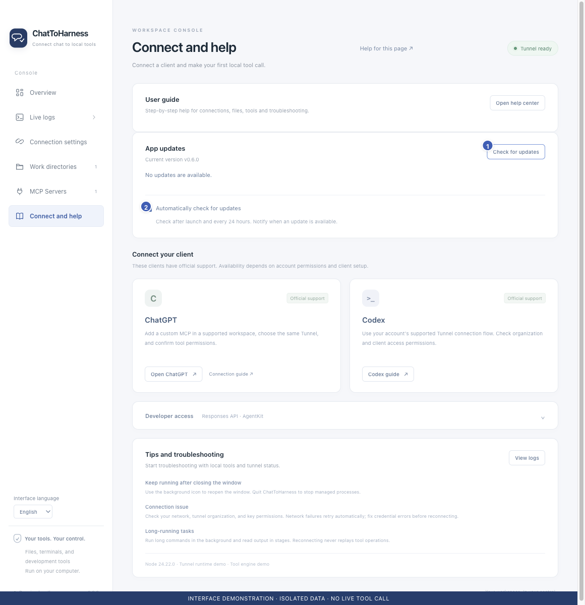

# Check for updates and install a new version

[English](../en/updates.md) | [简体中文](../zh-CN/updates.md) | [日本語](../ja/updates.md)

> For ChatToHarness 0.6.0.

## Your goal

Read what changed and install the release for your system.

## Before you start

Save unfinished settings and files and inspect running work, especially independent persistent tasks.

## Steps

1. In Connect and help, choose Check for updates. The app menu and tray also offer this action.
2. Read release notes and check platform and signing information before updating.
3. Choose Download and install and wait for download and integrity verification.
4. After verification, the app stops the connection, opens the installer and quits. On Mac, drag the new app into Applications; on Windows, follow the wizard.
5. Reopen, verify the running version and settings, and reconnect. In your client, refresh the tool catalog or reconnect the plugin to load the updated tool descriptions and parameters, then run a [read-only check](first-task.md) and inspect the actual tool result.
6. Set automatic checks as desired. By default they start about ten seconds after launch, then every 24 hours, and notify without installing.

1 Check manually; 2 Automatic-check preference. Interface demonstration using the current repository UI and isolated sample data; not evidence of a live tunnel or tool call.

## What success looks like

Version and update state are visible. Failed verification, missing assets or download failures do not start installation.

## If it does not work

Checks do not need a tunnel, and network errors do not interrupt tools. Development mode checks versions only. Updating does not guarantee cancellation of independent tasks; handle them first.

If an existing conversation still shows old parameters or is missing new tools, follow [Missing tools](missing-tools.md). Updating the desktop app alone does not refresh the client's tool catalog; **Tunnel ready** alone does not verify a client call.

## Next steps

- [Install ChatToHarness](installation.md)
- [Start, inspect and cancel background tasks](background-tasks.md)
- [Understand access, credentials and local records](privacy.md)
