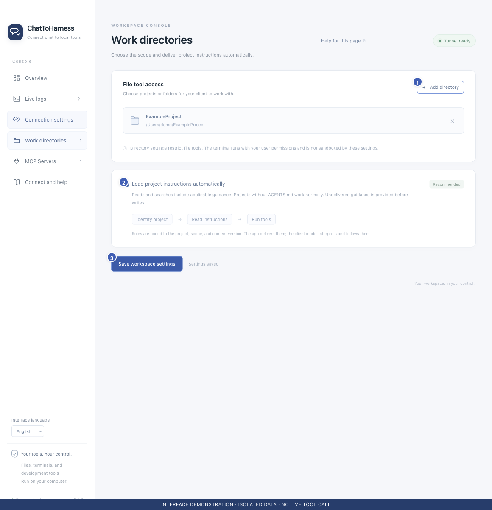

# Manage work directories and project instructions

[English](../en/work-directories.md) | [简体中文](../zh-CN/work-directories.md) | [日本語](../ja/work-directories.md)

> For ChatToHarness 0.6.0.

## Your goal

Choose file-tool access and provide applicable project instructions to your client.

## Before you start

Select only folders you intend to work with. Directory authorization is managed in the desktop app.

## Steps

1. Open Work directories, choose Add directory and select one or more project folders.
2. Remove an unneeded entry with its remove button, then save. Removing access does not delete disk files.
3. Leave automatic project instructions enabled when useful and save the directory settings.
4. Give the absolute project path in chat. Applicable AGENTS.md files and rules are supplied when present; projects without them still work.
5. If a first write asks to read instructions, have the client read them before continuing the original operation. Skills can be selected as needed.

1 Add a directory; 2 Automatic instructions; 3 Save settings. Interface demonstration using the current repository UI and isolated sample data; not evidence of a live tunnel or tool call.

## What success looks like

File tools use the saved folder scope. The client receives applicable instructions, although delivery does not guarantee that a model understands or follows them.

## If it does not work

Instruction problems can block writes while reading and diagnosis remain available. Changed instructions may need rereading. Folder permissions and remembered project approvals do not sandbox terminals or external processes.

## Next steps

- [Browse and organize files](files.md)
- [Resolve folder, credential or tool permission errors](permission-problems.md)
- [Understand access, credentials and local records](privacy.md)
