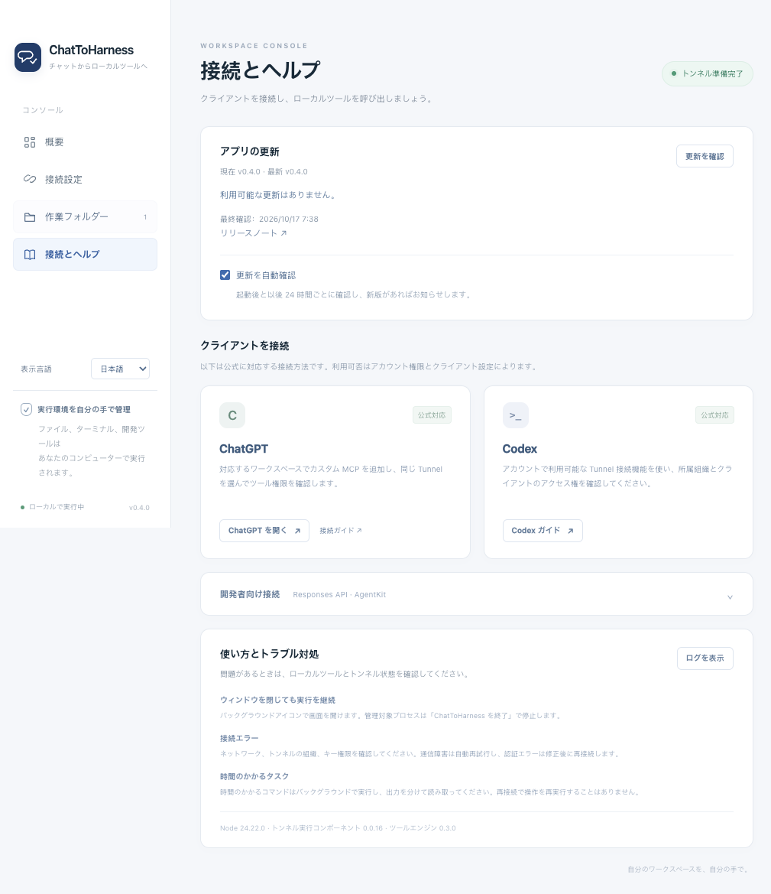

# ChatToHarness 利用ガイド

[English](../en/GUIDE.md) | [简体中文](../zh-CN/GUIDE.md) | [日本語](../ja/GUIDE.md)

**AI チャットをローカル実行環境につなぐ。**

ChatToHarness は、安全なトンネルを通じて、対応クライアントからローカルのファイル、ターミナル、Git、開発ツールを利用するためのデスクトップコンソールです。ツールを実行する前に、対象プロジェクトの規約をクライアントへ渡します。

[ドキュメント一覧](README.md) · [サイト・ダウンロード](https://dj-huang.github.io/ChatToHarness/ja/) · [リリース・チェックサム](https://github.com/DJ-Huang/ChatToHarness/releases) · [クライアント接続](CLIENTS.md) · [アーキテクチャ](ARCHITECTURE.md) · [検証記録](VERIFICATION.md) · [リリース管理](RELEASING.md)

## インストールと利用

対象は Apple Silicon 搭載の macOS 14 以降と Windows 11 x64 です。インストーラーには Node、Tunnel runtime、Desktop Commander が含まれ、別途開発環境を用意する必要はありません。インストール前に各 Release の署名情報を確認してください。既定のビルドは Windows では未署名、Mac ではアドホック署名のみで公証なしのため、OS が警告を表示したりインストールを制限したりする場合があります。

1. 公開済み Release から対応する `.dmg` または `-setup.exe` をダウンロードし、インストールして起動します。
2. [サービス管理画面](https://platform.openai.com/settings/organization/tunnels)で Tunnel を作成または選択し、Runtime API Key を用意します。対象の組織・ワークスペースに利用権限が必要です。
3. 「接続設定」に Tunnel ID と Runtime API Key を入力します。「作業フォルダー」でファイルツールがアクセスできるフォルダーを選択します。
4. 「保存して接続」を押します。ローカルツールの確認後に「トンネル準備完了」と表示されたら、「接続とヘルプ」に従ってクライアントを設定します。
5. 最初は読み取り専用の操作を試し、その後、専用の一時ディレクトリで書き込みと読み取りを確認します。

サイドバーの「表示言語」で日本語・英語・中国語を即座に切り替えられます。初回はシステム言語に従い、その他の言語では英語を使用します。以後は選択を記憶します。ネイティブメニュー、トレイ操作、状態、ヘルプ、エラー表示も切り替わります。独立した `preferences.json` に言語と更新確認設定を保存し、認証情報の読み書きやトンネルの再接続は行いません。サイトには別の言語切り替えがあり、ブラウザーで選択を記憶します。

API キーをチャットに送信したり、リポジトリへコミットしたりしないでください。保存するのは OS により暗号化されたキーだけです。画面には保存の有無のみを返し、保存後は入力欄を空にします。Runtime API Key を渡す先は Tunnel のみで、ツールプロセスには渡しません。API の呼び出し側には別の認証情報が必要です。

ウィンドウを閉じてもバックグラウンドで動作します。システムのトレイ／メニューバーアイコンを左クリックするとウィンドウが開き、右クリックで接続、停止、ログ、終了を選べます。「接続停止」はトンネルと全管理 MCP サービスを停止し、「ChatToHarness を終了」は管理下のプロセスを回収して終了します。再度起動すると既存のウィンドウを表示します。ログイン時の自動起動は既定で無効です。

「トンネル準備完了」はトンネルとローカルツールの準備ができたことを示します。クライアントの設定完了やツール呼び出しの成功を意味するものではありません。

## MCP Servers

MCP サーバー管理は v0.5.0 以降で利用できます。対応するインストーラーまたはソース開発用の入口を使用してください。

ChatToHarness の **MCP Servers** 画面でサービスを設定します。設定はアプリ単位で Tunnel のクライアントに共有され、個別 Agent に接続するものではありません。組み込みのファイルとターミナルツール名は維持します。Unity やブラウザーは通常の MCP サービスとして接続し、専用処理を ChatToHarness に組み込みません。外部サービスに作業ディレクトリは不要ですが、組み込みファイルツールには許可フォルダーが必要です。

1. 安定したサーバー ID、表示名、通信方式を追加します。`stdio` はコマンドと引数のリストを指定し、作業ディレクトリ、環境変数、Mac／Windows 別の上書きも設定できます。Streamable HTTP は URL と任意の静的ヘッダーを指定します。リモートは HTTPS 必須、HTTP はループバックのみです。OAuth と従来の HTTP+SSE は非対応です。
2. 認証値はアプリの秘密情報フィールドに保存します。システム暗号化で別に保存し、設定とエクスポートには参照だけを残します。保存済みの値を画面に返しません。サービスに必要な環境変数だけを設定してください。サービスはユーザー権限で動き、ファイルツールの許可フォルダーで隔離されません。
3. 接続前に実際のコマンドや URL を確認して信頼します。起動対象の変更後は再確認が必要です。接続テストは正常な既存接続を再利用し、検出したツールを呼びません。プレビューで接続状態とネゴシエーション済みプロトコルを確認できます。
4. ツールごとに無効、直接呼び出し、毎回ローカル確認を設定します。新規ツールは既定で無効、定義変更後は再許可が必要です。サーバーの読み取り専用注記は許可を与えません。承認は表示されたツール、引数、接続だけに適用し、呼び出し期限内に行います。
5. サービスを有効化して接続し、必要ならクライアントのツール一覧を更新します。外部ツール名は `serverId__toolName`（例：`unity__get_scene`）です。設定、信頼、呼び出し承認はデスクトップアプリで行います。

JSON インポートはアプリのエクスポート形式と一般的な `mcpServers` 設定に対応します。先にプレビューを確認してください。インポートしたサービスは既定で無効で、インポートはコマンドを実行しません。秘密情報、信頼記録、ツール権限はエクスポートしません。インポート後にローカルで秘密情報を補い、ツールを許可してから接続してください。

サービスの無効化はそのサービスだけを停止します。接続停止は Tunnel と全管理サービスを停止し、ウィンドウを閉じるだけなら継続します。通信障害は個別に再接続し、呼び出しを再実行しません。送信済みで応答を失った場合は対象アプリの状態を確認してから再試行を判断します。認証・設定・プロトコルの問題は修正が必要です。SDK `1.32.1` は `2026-07-28` だけを要求する相手に接続できません。

期限は承認待ちを含めて既定 60 秒、最大 90 秒で、シリアライズしたメッセージは 8 MiB までです。構造化結果と画像に対応します。集約対象はツールのみで、リソースやプロンプトの閲覧、sampling、elicitation は提供しません。診断ログに引数、結果本文、画像は保存しません。「トンネル準備完了」は新しいツールの検出や呼び出しを確認する状態ではありません。

## アプリの更新

「接続とヘルプ」の「アプリの更新」でバージョン確認とリリースノートを利用できます。アプリとトレイのメニューにも「更新を確認」があり、新版がある場合はサイドバーに表示します。

既定では起動 10 秒後と以後 24 時間ごとに安定版を確認します。「更新を自動確認」で無効にできます。トンネルや API キーは不要で、確認の失敗は接続やツールに影響しません。自動確認は通知だけを行い、ダウンロードとインストールはクリックで開始します。設定は言語と同じ独立した `preferences.json` に保存し、認証情報や接続を変更しません。

「ダウンロードしてインストール」は対応パッケージを取得し、サイズと SHA-256 を検証します。成功後に接続を停止し、インストーラーを開いてアプリを終了します。Mac は DMG の新版を「アプリケーション」にドラッグし、Windows はウィザードを使用します。未保存の設定を保存または破棄し、実行中の作業を終了してください。開発モードはバージョン確認のみです。パッケージ不足、取得失敗、検証失敗時はインストールしません。



隔離したデモ設定と模擬更新応答の画面です。実際の通道呼び出しの成功を示すものではありません。

## プロジェクト規約の自動読み込み

既定で有効です。作業内容とプロジェクトディレクトリを伝えてください。ファイル・検索・ターミナルのツールでは `project_path` で規約のルートも指定できます。

- AGENTS と rules は任意です。読み取り、一覧表示、検索は前提呼び出しなしで実行し、規約や診断を添えます。有効な `project_context_tokens` で既に渡した本文を再利用します。
- ルートから対象までの `AGENTS.md`／`agents.md` は各範囲に適用します。初回の書き込みに未読の規約があれば、実行せず本文と再試行トークンを返します。クライアントが読んで再試行します。規約がない場合は直接書き込めます。
- 通常の参照、存在しないファイル、`{en,zh-CN,ja}` のような省略表記は診断だけを返します。相対参照は AGENTS のディレクトリを基準とします。プロジェクト外の共有規約も許可フォルダー内なら読めますが、対象範囲や書き込み権限は拡張しません。
- 適用する AGENTS の競合、読み取り不可、本文の上限超過は書き込みのみを停止します。読み取りは続けられます。`get_project_context` で対象と `rule_paths` を明示でき、指定規約の取得失敗はその呼び出しだけに影響します。
- 規約本文は合計 64 KiB までで、黙って切り詰めません。渡した規約の変更は再読を要求しますが、無関係な索引変更では書き込みを止めません。メタデータでキャッシュを無効化し、追加・削除・入れ子の規約を検出します。

ファイルと規約は、シンボリックリンク解決後もアプリの許可フォルダーを検査します。フォルダーはデスクトップで変更し、`set_config_value` から `allowedDirectories` は変更できません。規約はユーザーやプラットフォームの指示に優先せず、本文を渡してもモデルの遵守は保証しません。

## 検索と復旧

コード検索には `search_project` を優先し、`project_path` と `pattern` を指定します。既定は文字列検索、`regex` は正規表現、`ignore_case` は大文字小文字を区別しない検索、`search_type="files"` はファイル名／glob 検索です。`include_globs` と `exclude_globs` で範囲を絞れます。既定で除外規則に従い、バイナリーを読み飛ばします。絶対パス、1 始まりの行番号、前後各 2 行を返します。`read_file` の `offset` は 0 始まりのままなので、N 行目は N−1 を指定します。

既定は 1 ページ 100 件、検索時間は 2 秒（最大 10 秒）です。保存は 1,000 件・2 MiB まで、結果の 1 ページは 64 KiB までで、規約本文の予算とは別です。時間・件数・サイズ上限、読み取り不可、該当なしを区別します。長い行や省略した断片には印を付けます。`next_cursor` は再走査せず保存結果を読み、プロジェクトとクエリーに対応し、5 分間未使用で失効します。同時検索は 4 件までです。従来のストリーミング検索も使用できます。

ゲートウェイの呼び出し期限はローカル承認待ちを含めて既定 60 秒、最大 90 秒です。組み込みプロキシの長い明示的な待機でも、この全体の期限を延長できません。転送前のタイムアウトは `execution_state="not_started"`、転送後は `"unknown"` とし、書き込み・追記・移動・コマンドを自動再実行しません。読み取り／検索は状態を確認して再試行できます。既知の処理の停止は規約更新に妨げられず、再接続で失効したハンドルは明示的に報告します。

フォルダー設定は**ターミナルのサンドボックスではありません**。Shell はユーザーの権限と実際の環境で動きます。関連する `context_paths` を指定し、通常のシステム診断では `[]` を使います。長時間の処理はバックグラウンドで実行し、出力を分けて読み取ります。停止と終了で管理下のプロセスを回収します。

## 開発時にソースを直接実行

Mac は `Dev.command`、Windows は `Dev.cmd` をダブルクリックします。初回は固定された Node、Electron、ツールを準備するため通信が必要です。以後は現在の `app/` を読み込み、**アプリやインストーラーのパッケージ作成は行いません**。依存関係が準備済みなら `npm run dev` または `npm start` でも起動できます。

コード変更後、同じ入口を再実行すると再起動します。ファイル保存の自動監視は行いません。旧インスタンスが正常終了要求を受け、通道とツールを停止し、再接続を取り消して単一インスタンスのロックを解放してから、新インスタンスが現在のソースを読み込みます。既存のディレクトリ、認証情報、設定の保存先は維持します。新しい実行プログラムの初回はキーチェーンの許可が必要な場合があります。

開発用ターミナルは開いたままにします。Ctrl+C またはターミナルを閉じる操作で開発実行が終了します。アプリのウィンドウを閉じた場合は従来どおりバックグラウンドに隠れ、開発入口の再実行で置き換えられます。再起動すると実行中のツールタスクは終了します。

開発再起動のプロトコルを持たない旧版から初めて切り替える際は、旧アプリのメニューで一度「ChatToHarness を終了」を選択します。ウィンドウを閉じるだけでは終了しません。旧インスタンスが終了しなければ最大 15 秒でエラーを返し、サービスを二重に起動しません。以後は開発入口から再起動できます。固定依存の更新時に Windows が使用中のコンポーネントを報告した場合も、旧開発インスタンスを終了してから再実行します。

## ソースからのワンクリック起動

Mac は `Start.command`、Windows は `Start.cmd` をダブルクリックします。初回は固定された依存関係を準備してビルドし、以後は作成済みアプリを再利用します。初期準備には固定バージョンのコンポーネントを取得するための通信が必要です。通常起動では依存関係の更新確認を行いません。

開発とビルドには Node 24.22.0 を使用します。

```sh
npm ci
npm test
npm run build
npm run dist
```

`build` は展開済みのネイティブアプリ、`dist` は DMG または NSIS インストーラーを生成します。対象に一致する OS とアーキテクチャでビルドしてください。Mac の依存関係を Windows にコピーして使用することはできません。CI は Mac arm64 と Windows x64 のネイティブ環境でビルドとインストールを検証します。

## 設定と旧版との互換性

Mac の既存 LocalHarness データは `~/Library/Application Support/LocalHarness` に保持します。改名でキーを失わないよう、内部識別子とキーチェーンの名前空間を維持します。OS が再度許可を求める場合があります。復号に失敗しても元のファイルは保持され、アプリからキーを再入力できます。Windows はシステムのユーザーデータディレクトリを使用します。テストでは一時ディレクトリで上書きし、個人設定は使いません。

アプリ設定、ツール設定、ログは専用の非公開データディレクトリに保存します。実際の HOME／USERPROFILE を保持し、Git、SSH、開発ツールは既存のユーザー設定を利用します。クライアントにローカル stdio やローカル HTTP の接続先を追加しないでください。外部クライアントとの接続は既存 Tunnel のみです。

## トラブルシューティング

| 状況 | 対処 |
| --- | --- |
| ツールのコンポーネント確認に失敗 | ログを確認します。ソース版は起動スクリプトで再準備し、インストール版は対象 OS に合うパッケージを再インストールします。 |
| キーを読めない／システム許可待ち | システム画面で許可します。解決しない場合は元の設定ファイルを削除せず、キーを再入力します。 |
| 認証情報または権限のエラー | Runtime API Key、Tunnel の関連付け、Read + Use 権限を確認して再接続します。 |
| 通信切断 | 間隔を空けて自動再接続します。手動で再接続・停止もできます。ツール操作は再実行しません。 |
| クライアントにトンネルが見えない | 組織・ワークスペースの関連付けを確認し、アプリを起動したまま「トンネル準備完了」を確認します。 |
| プロジェクトコンテキストが期限切れ | クライアントに規約を再取得させ、その後で操作を明示的に再試行します。 |
| Windows がインストールを制限 | 配布元、SHA-256、Release の署名情報を確認します。正式署名には管理者側の証明書が必要です。 |

「查看日志」でログフォルダーを開けます。サポート用の資料からキー、環境変数の全出力、個人プロジェクトの内容を取り除いてください。

## オープンソースと保守

MIT License で配布します。[第三者コンポーネント](THIRD_PARTY_NOTICES.md)と[ライセンス](LICENSE.md)を参照してください。公開リポジトリには認証情報、マシン固有の設定、ログ、チャット記録、依存関係、ビルド成果物を含めません。インストーラーは GitHub Releases で配布し、サイトで認証情報を収集しません。
