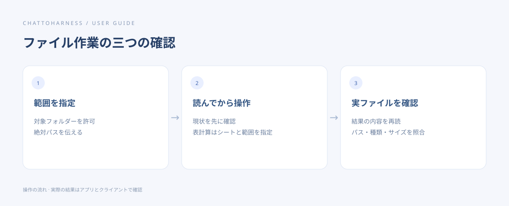

# 成果物を確認して取得する

[English](../en/artifacts.md) | [简体中文](../zh-CN/artifacts.md) | [日本語](../ja/artifacts.md)

> ChatToHarness 0.6.0 対象。

## 目的

タスクが実際に生成したファイルを見つけ、内容を確認します。

## 始める前に

プロジェクトと出力先を把握します。ファイルツールで読めるのは許可範囲内の成果物です。

## 操作手順

1. タスク開始時に保存先を指定します。
2. 終了後、実在するファイルのパス・サイズ・種類を求めます。
3. テキストは必要に応じて分割し、対応する小さな画像はプレビューします。大きなファイルは分割して返る場合があります。
4. クライアントに実際の添付やリンクがあれば利用します。なければ本機のファイル管理画面で開きます。
5. 重要な内容とサイズを確認し、最終版を保存します。

### コピーして使える例文

例のパスは許可済みのプロジェクトの絶対パスに置き換えます。Windows では自分のドライブのパスを使ってください。

```text
/Users/demo/ExampleProject/output に実在するファイルのパス・サイズ・種類を一覧にし、対応する画像を表示してください。存在しないファイルを生成済みと報告しないでください。
```



操作の順序を示す図です。クライアントが実際に実行した結果ではありません。

## 完了時の状態

実在しアクセス可能なファイルを確認できます。会話にファイル名があるだけでは生成や添付の証拠になりません。

## うまくいかない場合

見つからない場合は完了状態、出力先、権限を確認します。返答の制限と破損は別です。分割して読むか本機で開いてください。すべてのクライアントにダウンロードボタンが出るとは限りません。

## 次のステップ

- [文書・画像・表計算を読む](reading.md)
- [バックグラウンドタスクを開始・確認・取消する](background-tasks.md)
