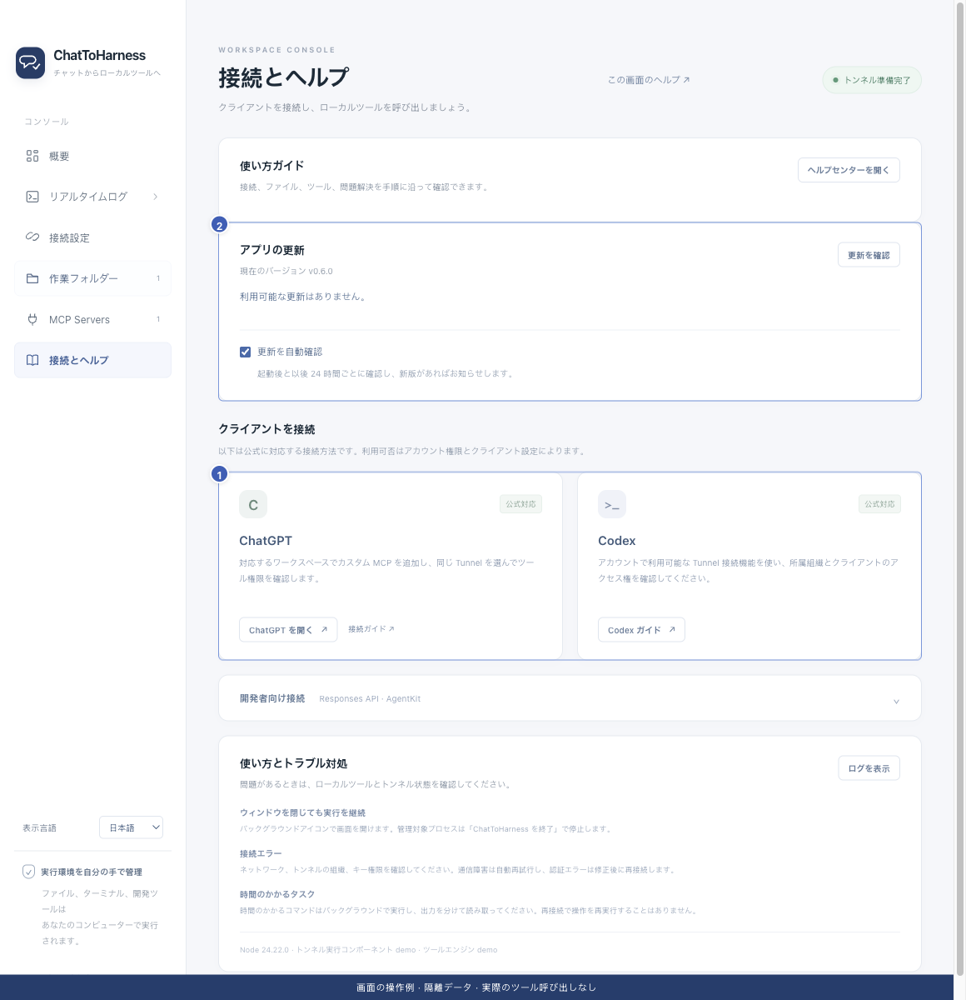

# ChatGPT に接続する

[English](../en/chatgpt.md) | [简体中文](../zh-CN/chatgpt.md) | [日本語](../ja/chatgpt.md)

> ChatToHarness 0.6.0 対象。

## 目的

本機で準備したツールを ChatGPT から使います。

## 始める前に

本機のトンネルが準備完了で、カスタム MCP の追加とトンネル利用の権限が必要です。

## 操作手順

1. ChatGPT のプラグイン／アプリ管理で、利用可能なカスタム MCP 追加の手順を開きます。
2. Connection で Tunnel を選び、本機と同じ Tunnel ID を指定します。
3. アカウントやワークスペースの承認を終え、ツール一覧が表示されるのを待ちます。
4. 会話でプラグインを選び、最初の読み取り確認を行います。既存の接続名が LocalHarness のままの場合もあります。
5. アプリやツールの更新後は詳細画面でツールを更新し、読み取りで確認します。

1 クライアント接続案内、2 アプリ更新。 現在のリポジトリの画面と隔離サンプルによる操作例です。実際の接続やツール実行の成功を示していません。

## 完了時の状態

実際のツール結果から本機の情報を取得できます。トンネルの表示、ツールの検出、実行の成功は別々に確認します。

## うまくいかない場合

入口やトンネルが見えない場合は管理者に関連付けと権限の確認を依頼します。ChatGPT の確認と本機の許可は別のものです。下の公式案内も参照してください。

[OpenAI 公式接続ガイド](https://developers.openai.com/api/docs/guides/custom-mcp-server)

## 次のステップ

- [初めてのタスクを完了する](first-task.md)
- [クライアントにトンネルやツールが見つからない](missing-tools.md)
- [ツールの権限と本機の確認を管理する](tool-permissions.md)
