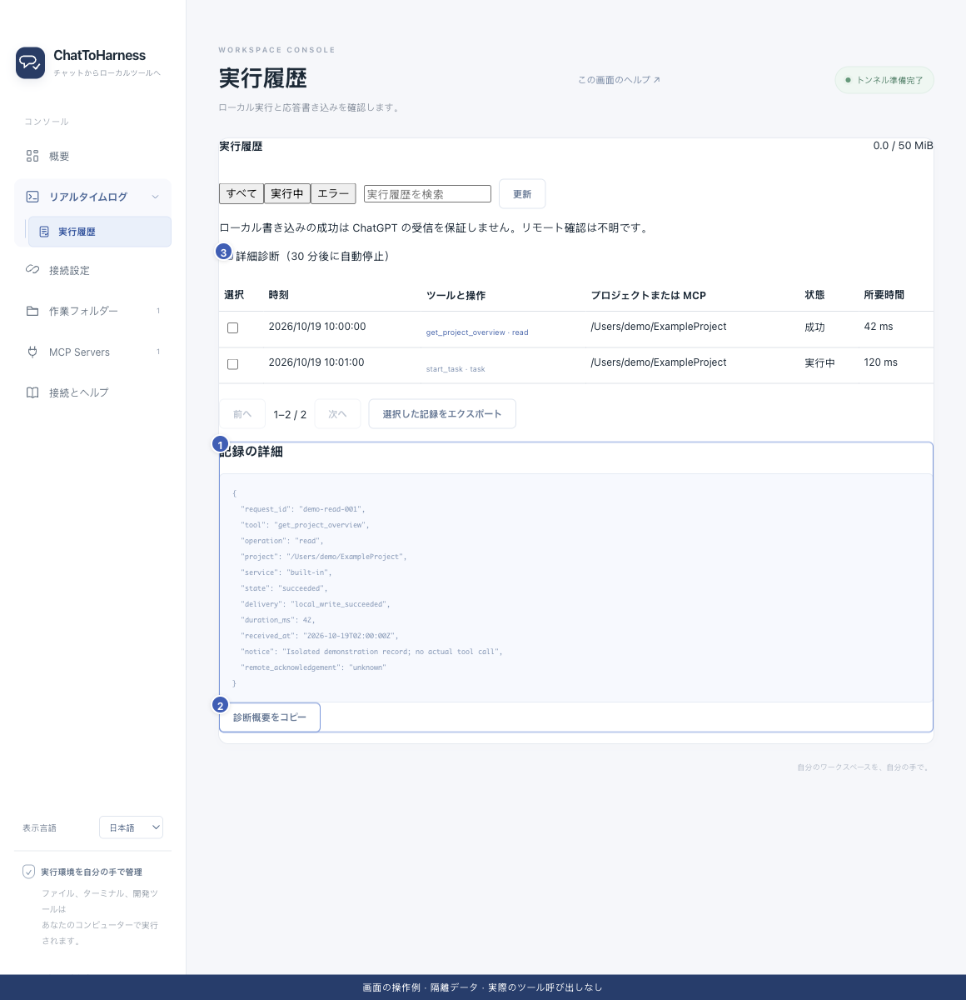

# 診断情報・詳細・履歴を書き出す

[English](../en/diagnostics.md) | [简体中文](../zh-CN/diagnostics.md) | [日本語](../ja/diagnostics.md)

> ChatToHarness 0.6.0 対象。

## 目的

特定の問題に必要な情報を集め、共有前に確認します。

## 始める前に

再現手順を整理し、通常の履歴で説明できるか先に確認します。

## 操作手順

1. 必要な場合だけ実行履歴で詳細診断を有効にします。30分後に自動で終了し、手動でも止められます。
2. 一度再現して時刻と依頼 ID を控えます。データを変える操作を繰り返さないでください。
3. 該当する詳細を開いてコピーします。
4. 必要な記録を選んで JSON に書き出します。一度に最大100件を選択できます。
5. 個人のパス、内容、引数などを確認して取り除き、問題報告に添付します。

1 詳細、2 詳細コピー、3 詳細診断。 現在のリポジトリの画面と隔離サンプルによる操作例です。実際の接続やツール実行の成功を示していません。

## 完了時の状態

選んだ履歴と時系列が得られます。全設定や会話のバックアップではありません。

## うまくいかない場合

履歴にユーザーデータが含まれることがあり、完全な秘匿処理は保証されません。整理対象のログは合計50 MiB、実行履歴は最大7日または10,000件です。重要な証拠は早めに保存してください。

## 次のステップ

- [アクセス範囲・認証情報・記録を理解する](privacy.md)
- [よくある質問と問い合わせ](faq.md)
- [実行履歴を探して読み取る](execution-records.md)
