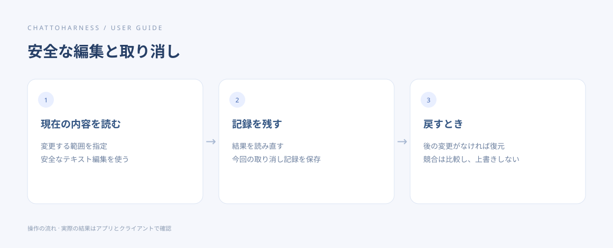

# ファイルを変更し、安全な編集を戻す

[English](../en/editing.md) | [简体中文](../zh-CN/editing.md) | [日本語](../ja/editing.md)

> ChatToHarness 0.6.0 対象。

## 目的

指定した内容を変更し、対応している場合は元に戻す記録を残します。

## 始める前に

現在の内容を先に読み、重要な資料はコピーします。安全なテキスト編集は 1 MiB 以下の通常の UTF-8 ファイルが対象です。

## 操作手順

1. 対象、変更内容、残す内容を伝え、現在のファイルを読ませます。
2. テキストは安全な編集と取り消し記録の保存を依頼します。新規作成では同じパスが未使用か確認します。
3. 再度読み、意図した箇所だけが変わったか確認します。
4. 元に戻す場合は、対象の編集とその取り消し記録を指定します。
5. Word、Excel、PDF は専用の形式ツールを使います。安全なテキスト取り消しが自動で付くわけではありません。

### コピーして使える例文

例のパスは許可済みのプロジェクトの絶対パスに置き換えます。Windows では自分のドライブのパスを使ってください。

```text
/Users/demo/ExampleProject/notes.txt を読んで、見出し「下書き」を「議事録」に安全なテキスト編集で変更してください。取り消し記録を残し、結果を読み直してください。
```



操作の順序を示す図です。クライアントが実際に実行した結果ではありません。

新規、追記、部分置換のどれかを指定します。Word の段落や表のセルは、段落またはシートと範囲を明示して変更後に読み直します。

## 完了時の状態

安全な編集が成功すると取り消し記録が返ります。取り消しに成功すれば、その編集前の内容に戻ります。

## うまくいかない場合

後から別の変更があれば、取り消しは上書きを拒否します。現在の内容を比較して対処してください。コマンドや移動などすべての操作が戻せるわけではなく、同時の外部書き込みも完全には防げません。

## 次のステップ

- [文書・画像・表計算を読む](reading.md)
- [タイムアウト・状態不明・返答なしに対処する](uncertain-results.md)
