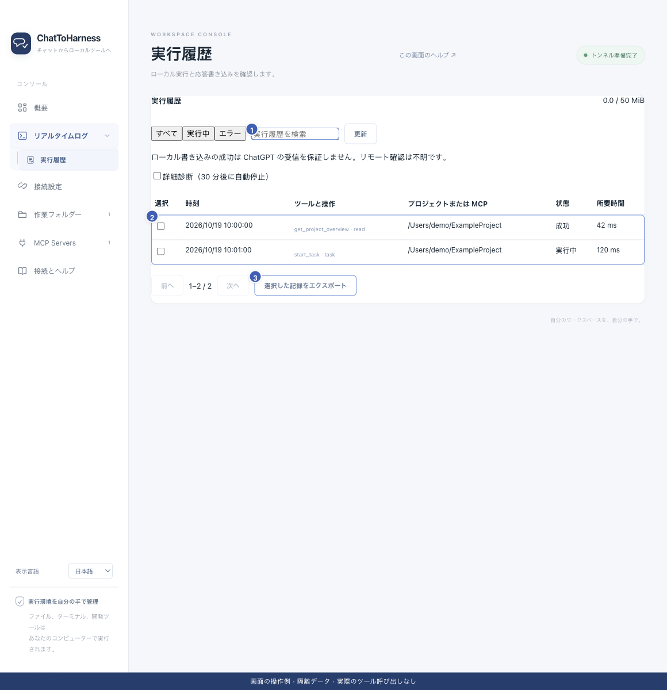

# 実行履歴を探して読み取る

[English](../en/execution-records.md) | [简体中文](../zh-CN/execution-records.md) | [日本語](../ja/execution-records.md)

> ChatToHarness 0.6.0 対象。

## 目的

続行や再試行の前に、本機で何が起きたか確認します。

## 始める前に

サイドバーのログを展開するか、ログ画面のショートカットを使います。

## 操作手順

1. 実行履歴で、すべて・実行中・エラーを切り替えます。
2. ツール名、依頼 ID、プロジェクトで検索し、更新やページ移動を使います。
3. 対象のツールと操作を押して詳細を開きます。
4. 時刻、対象、実行状態、所要時間、関連タスクを確認します。
5. 本機の実行成功、本機の通信路への書き込み、クライアントの受信を区別します。
6. タスク ID があれば、重複開始せず同じタスクを調べます。

会話では許可済みの `project_path` と `state:"errors"` を指定して `get_execution_summary` を直接呼び出すと、最近のエラーを確認できます。依頼 ID、ツール名、状態、所要時間、エラー理由、関連タスク ID を返し、元の引数や出力全文は含みません。既定は 10 件、最大 50 件です。`tool`、`since`、返されたカーソルで絞り込みやページ移動ができます。

1 検索、2 履歴一覧、3 選択した記録の出力。 現在のリポジトリの画面と隔離サンプルによる操作例です。実際の接続やツール実行の成功を示していません。

## 完了時の状態

依頼と本機の記録を対応させ、確認できた段階が分かります。クライアントの受信確認がなければ受信は不明の場合があります。

## うまくいかない場合

記録が見えなくても未実行の証明にはなりません。保持期限や絞り込みを確認します。状態不明の書き込みは、再試行前に実ファイルや外部アプリを調べます。

## 次のステップ

- [タイムアウト・状態不明・返答なしに対処する](uncertain-results.md)
- [診断情報・詳細・履歴を書き出す](diagnostics.md)
- [バックグラウンドタスクを開始・確認・取消する](background-tasks.md)
