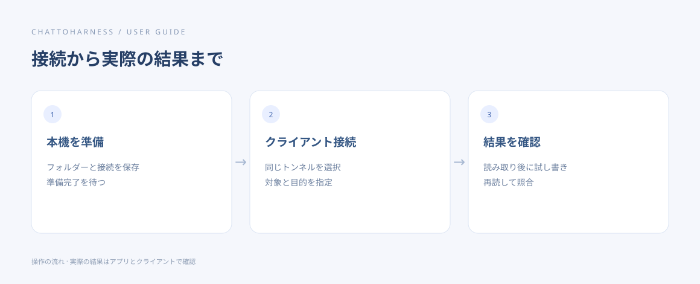

# 初めてのタスクを完了する

[English](../en/first-task.md) | [简体中文](../zh-CN/first-task.md) | [日本語](../ja/first-task.md)

> ChatToHarness 0.6.0 対象。

## 目的

読み取りと専用ファイルの試し書きで、接続全体を確認します。

## 始める前に

空の試用フォルダーを許可し、トンネルとクライアントのツール一覧を準備します。例のパスは自分の絶対パスに置き換えてください。

## 操作手順

1. クライアントで接続済みプラグインを選び、下の読み取り例文を送ります。
2. 実際のツール結果にフォルダーやプロジェクト情報が表示されることを確認します。モデルの「完了しました」という返答だけでは確認できません。
3. 試用フォルダーに未作成の hello-harness.txt を作り、「接続テスト」と書いて再度読むよう依頼します。
4. 返された内容と本機のファイルを照合し、実行履歴でも呼び出しを確認します。
5. 片付ける場合はテストファイルだけを指定するか、自分でファイル管理画面から削除します。

### コピーして使える例文

例のパスは許可済みのプロジェクトの絶対パスに置き換えます。Windows では自分のドライブのパスを使ってください。

```text
/Users/demo/ExampleProject の概要とファイル一覧を見せてください。ファイルは変更しないでください。
```



操作の順序を示す図です。クライアントが実際に実行した結果ではありません。

## 完了時の状態

読み取り結果と試し書き後の内容が一致すれば、実際のツール呼び出しを確認できています。

## うまくいかない場合

返答がない場合は再作成する前に実行履歴を調べます。工程規約の読み取りを求められた場合は、クライアントに読ませて元の依頼を続けます。

## 次のステップ

- [文書・画像・表計算を読む](reading.md)
- [ファイルを変更し、安全な編集を戻す](editing.md)
- [実行履歴を探して読み取る](execution-records.md)
