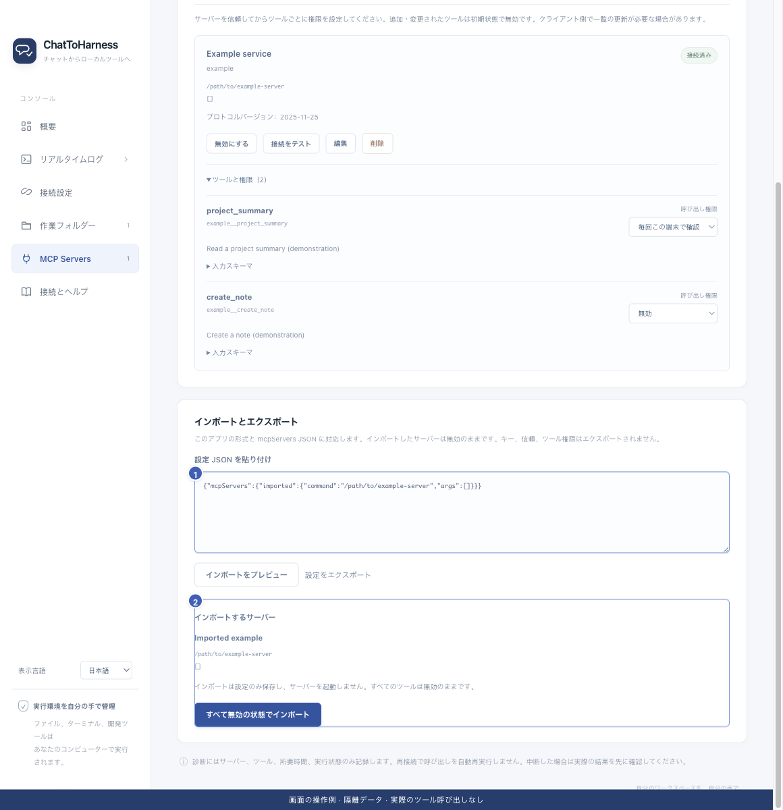

# ツール設定をインポート・エクスポートする

[English](../en/import-export.md) | [简体中文](../zh-CN/import-export.md) | [日本語](../ja/import-export.md)

> ChatToHarness 0.6.0 対象。

## 目的

サービス設定を再利用し、移動先でキーと権限を設定し直します。

## 始める前に

信頼できる設定だけを使います。移動先では起動パスの変更が必要な場合があります。

## 操作手順

1. MCP Servers の入出力欄に、本アプリの出力または一般的な mcpServers 設定を貼り付けます。
2. プレビューでサービス、コマンド、URL、不足項目を確認します。この時点では起動しません。
3. 確認後、すべて無効の状態でインポートします。
4. 移動先でキーとパスを補い、信頼、ツールの権限、接続を設定します。
5. 出力する場合は設定をエクスポートし、コピーを適切な場所に保存します。

1 信頼する設定、2 プレビューと確定。取込後は無効です。 現在のリポジトリの画面と隔離サンプルによる操作例です。実際の接続やツール実行の成功を示していません。

出力後は設定をコピーして保存します。実行履歴の選択項目を書き出す操作とは別です。

## 完了時の状態

インポートしたサービスは無効のままです。出力にキーの値、信頼、権限は含まれず、完全なアカウントバックアップではありません。

## うまくいかない場合

競合や期限切れならプレビューし直します。未知のコマンドをそのまま実行しないでください。OS 間ではパスと上書きを確認します。トンネルキー、作業フォルダー、すべての個人設定は出力に含まれません。

## 次のステップ

- [ローカル MCP サービスを追加する](local-services.md)
- [ツールの権限と本機の確認を管理する](tool-permissions.md)
- [接続の認証情報を変更・消去する](credentials.md)
