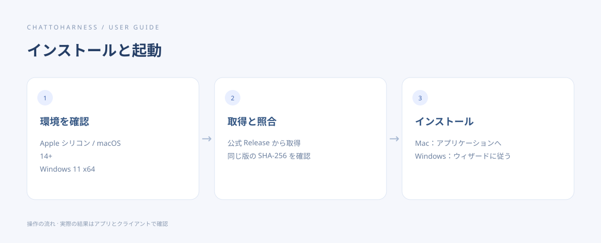

# インストールや起動の問題を解決する

[English](../en/installation-problems.md) | [简体中文](../zh-CN/installation-problems.md) | [日本語](../ja/installation-problems.md)

> ChatToHarness 0.6.0 対象。

## 目的

配布元、動作条件、警告の内容から原因を調べます。

## 始める前に

ファイル名と OS の警告を残し、既存設定を先に削除しないでください。

## 操作手順

1. Apple シリコンの macOS 14 以降、または Windows 11 x64 か確認します。
2. 公式 GitHub Release の名前と SHA-256 に一致するか照合します。
3. Mac はアプリケーションへ移して起動します。公証の警告では、配布元を確認してからシステム設定で対処します。
4. Windows の署名や評価の警告は、その版の未署名に関する説明と実ファイルを確認します。
5. 同梱の構成要素が使えない場合は対応する版を再取得し、エラーを保存します。

操作の順序を示す図です。クライアントが実際に実行した結果ではありません。

## 完了時の状態

条件と配布元を確認して、起動できるか、具体的な阻害要因を特定できます。

## うまくいかない場合

OS の保護全体を無効にしないでください。起動しないと思ったときはトレイからウィンドウを戻せるか確認します。再インストールのために個人データを消す必要はありません。

## 次のステップ

- [ChatToHarness をインストールする](installation.md)
- [よくある質問と問い合わせ](faq.md)
