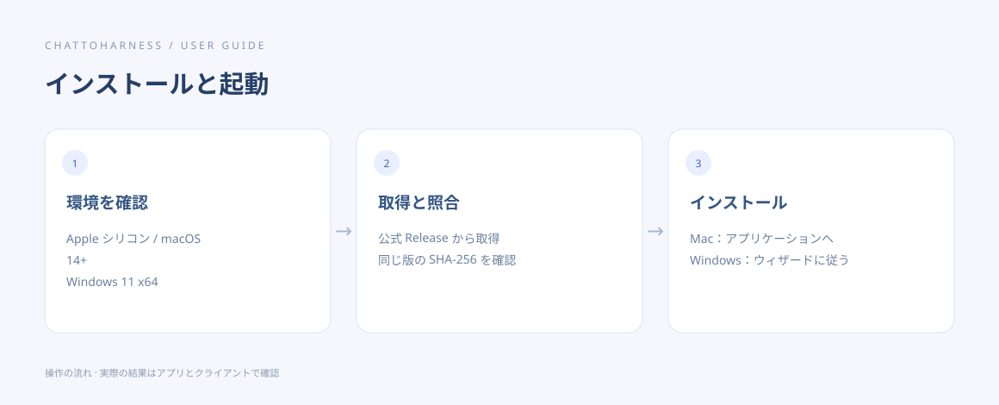

# ChatToHarness をインストールする

[English](../en/installation.md) | [简体中文](../zh-CN/installation.md) | [日本語](../ja/installation.md)

> 以下のファイル名と署名の説明は、公開済みの [v0.8.1 Release](https://github.com/DJ-Huang/ChatToHarness/releases/tag/v0.8.1) に対応します。別のバージョンでは、そのリリースのファイル名、チェックサムファイル、説明を使用してください。

## 目的

パソコンに合う正式版をインストールし、コンソールを開きます。

## 始める前に

動作条件とアカウントを確認し、公式サイトから GitHub Releases を開きます。

## 操作手順

1. 公式 Release から、利用する OS 向けのインストーラーをダウンロードします。Mac は Apple シリコン用の .dmg、Windows は x64 用の -setup.exe を選びます。
2. 同じリリースの SHA256SUMS.txt もダウンロードします。インストーラーを開く前に、以下の手順で照合し、そのリリースの署名に関する説明を読みます。
3. 照合後にインストールします。Mac：.dmg を開き、アプリを「アプリケーション」にドラッグします。Windows：-setup.exe を実行し、ウィザードに従います。
4. アプリを開き、概要・接続設定・作業フォルダーなどの項目を確認します。

### 開く前にダウンロードしたファイルを確認する

以下は読み取り専用のコマンドです。両方のファイルを「ダウンロード」フォルダーに元のファイル名で保存した場合を示します。別の場所に保存した場合や、重複ダウンロードでブラウザーが名前を変更した場合は、パスを置き換えてください。インストーラーと SHA256SUMS.txt は同じリリースのものを使用し、リポジトリのソースコード ZIP をインストーラーとして使わないでください。

Mac では「ターミナル」を開いて実行します。

```sh
shasum -a 256 "$HOME/Downloads/ChatToHarness-0.8.1-macos-arm64.dmg"
cat "$HOME/Downloads/SHA256SUMS.txt"
```

Windows では PowerShell を開いて実行します。

```powershell
(Get-FileHash -Algorithm SHA256 -LiteralPath "$HOME\Downloads\ChatToHarness-0.8.1-windows-x64-setup.exe").Hash
Get-Content -LiteralPath "$HOME\Downloads\SHA256SUMS.txt"
```

最初のコマンドはダウンロードしたファイルの SHA-256 を表示します。この 64 桁の値を、SHA256SUMS.txt の**同じインストーラーファイル名**の行にある値と照合します。英字の大文字と小文字は区別しません。両方の OS が記載されていますが、ダウンロードしたインストーラーだけを確認してください。値全体が一致した場合にのみ次へ進みます。

ファイルが見つからない場合はパスを修正します。値が異なる場合はインストーラーを開かず、ファイル名とバージョンを確認し、公式 Release からインストーラーとチェックサムファイルを再ダウンロードしてください。一致は公開されたチェックサムとファイルのバイト列が合うことを示すだけで、コード署名の代わりにはならず、公証やソフトウェアの安全性を保証するものでもありません。システムの保護機能は有効のままにしてください。



操作の順序を示す図です。クライアントが実際に実行した結果ではありません。

## 完了時の状態

コンソールが表示されます。インストールだけではトンネルは接続されないため、続いて接続情報を設定します。

## うまくいかない場合

v0.8.1 の Mac アプリはアドホック署名のみで公証なし、Windows 版は未署名のため、OS が警告したりインストールを止めたりする場合があります。配布元、チェックサム、リリースの説明を確認してから続行するか判断し、保護機能全体は無効にしないでください。

[GitHub Releases](https://github.com/DJ-Huang/ChatToHarness/releases)

## 次のステップ

- [初めて接続する](first-connection.md)
- [インストールや起動の問題を解決する](installation-problems.md)
