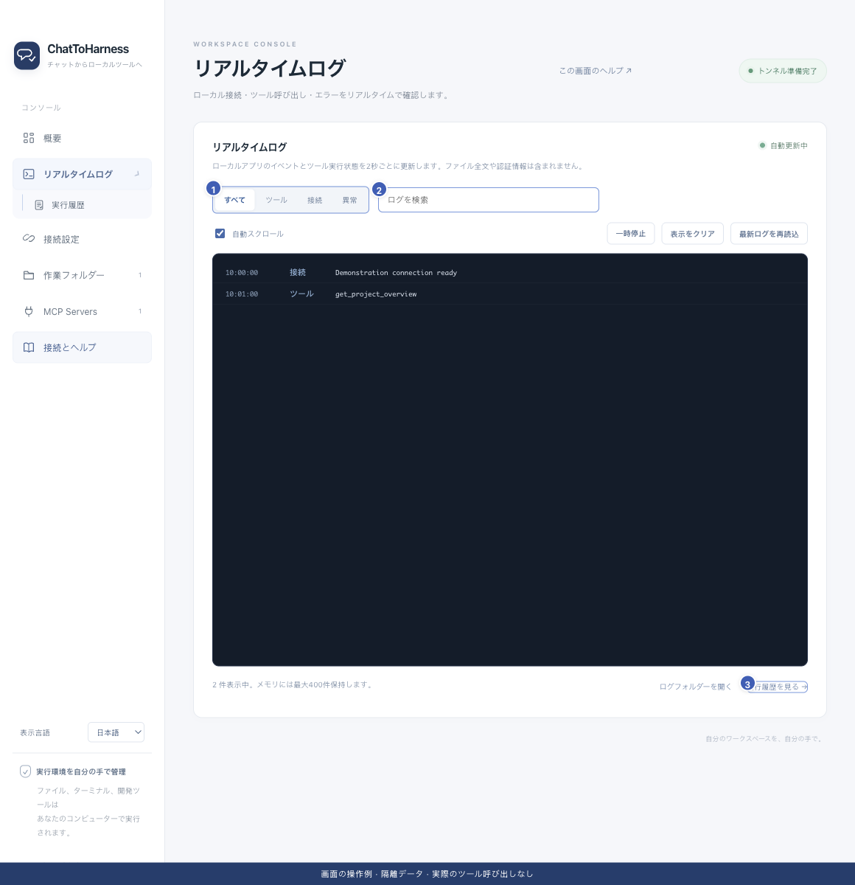

# リアルタイムログを絞り込む

[English](../en/live-logs.md) | [简体中文](../zh-CN/live-logs.md) | [日本語](../ja/live-logs.md)

> ChatToHarness 0.6.0 対象。

## 目的

接続とツールの状況を、更新される一覧で確認します。

## 始める前に

アプリで何らかの動作が必要です。ログは最近のイベントであり、会話の全文ではありません。

## 操作手順

1. サイドバーまたは概要からリアルタイムログを開きます。
2. すべて、ツール、接続、異常で絞り込みます。
3. ツール名、依頼 ID、キーワードを検索し、見つからなければ検索を消して分類を変えます。
4. 読む間は一時停止し、後で再開できます。自動スクロールも切り替えられます。
5. 再読込は最近の表示を更新します。表示クリアでディスク上のログは削除されません。
6. 下部からログフォルダーや実行履歴を開きます。

1 分類、2 検索、3 実行履歴の入口。 現在のリポジトリの画面と隔離サンプルによる操作例です。実際の接続やツール実行の成功を示していません。

## 完了時の状態

約2秒ごとに更新します。表示を止めてもツールの処理は止まりません。

## うまくいかない場合

表示件数には上限があり、大量のイベントでは途中が省かれる場合があります。完全な監査記録ではありません。規約や引数を待つ未実行の依頼は、すべて／ツール側で探してください。

## 次のステップ

- [実行履歴を探して読み取る](execution-records.md)
- [診断情報・詳細・履歴を書き出す](diagnostics.md)
