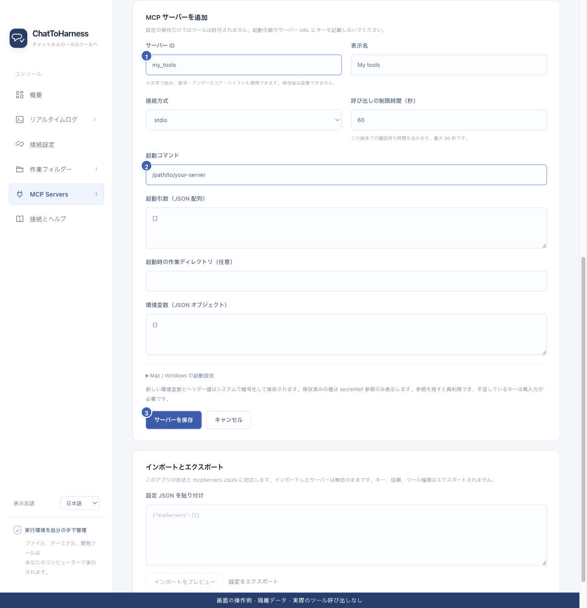

# ローカル MCP サービスを追加する

[English](../en/local-services.md) | [简体中文](../zh-CN/local-services.md) | [日本語](../ja/local-services.md)

> ChatToHarness 0.6.0 対象。

## 目的

パソコンに入れた外部ツールを本アプリに接続します。

## 始める前に

ツールの公式手順でサービスを入れ、起動コマンド・引数・キーを用意します。すべての外部ツールが自動で入るわけではありません。

## 操作手順

1. 「プラグイン」で「プラグインを追加」を選び、「MCP サーバーに接続」を開きます。
2. 固定のサービス ID と表示名を入力します。ID は保存後に変えられません。my_tools などを使います。
3. 接続方式を stdio にし、公式手順のコマンドと引数を入力します。引数なしは []、各引数は別々の文字列です。
4. 必要なら起動先と環境変数を指定します。キーは専用欄に入れ、引数に含めません。
5. OS ごとにパスが違う場合は Mac / Windows の上書きを使います。呼び出し時限には本機の確認待ちも含まれます。
6. 保存後、信頼の確認、接続テスト、ツールごとの許可へ進みます。

1 固定 ID、2 公式の起動コマンド、3 設定保存。 現在のリポジトリの画面と隔離サンプルによる操作例です。実際の接続やツール実行の成功を示していません。

## 完了時の状態

サービスが一覧に追加されます。保存だけでは権限付与や接続の成功にはなりません。

## うまくいかない場合

起動できない場合はインストールと絶対パスを確認します。空白を含む引数は一つの要素にします。サービスはユーザー権限で動き、フォルダー許可では隔離されません。図のコマンドは例です。

## Computer Use

Computer Use と外部プラグインは同じ一覧に表示され、「内蔵」と「MCP」で区別されます。「管理」を選ぶと、プラグイン画面の右側に管理パネルが開きます。操作の切り替えとシステム権限の確認を行えます。閉じるとプラグイン一覧に戻ります。外部プラグインでは「概要と権限」「接続設定」を管理します。一括追加は「プラグインを追加 → 設定をインポート」、全体の MCP 権限とエクスポートは「プラグイン設定」から開きます。

macOS では画面収録とアクセシビリティ権限が必要です。権限の確認は状態を読み取るだけで、操作を有効にしません。権限が不足している場合、有効化時に許可ダイアログを表示します。権限はアプリと起動元に依存するため、開発版の確認はインストール版の許可を保証しません。

リポジトリ直下の `./dev.sh` は `Start.sh --dev` と同じ開発起動フローです。

## 次のステップ

- [サービスを信頼して接続テストする](service-trust.md)
- [ツールの権限と本機の確認を管理する](tool-permissions.md)
- [ツール設定をインポート・エクスポートする](import-export.md)
