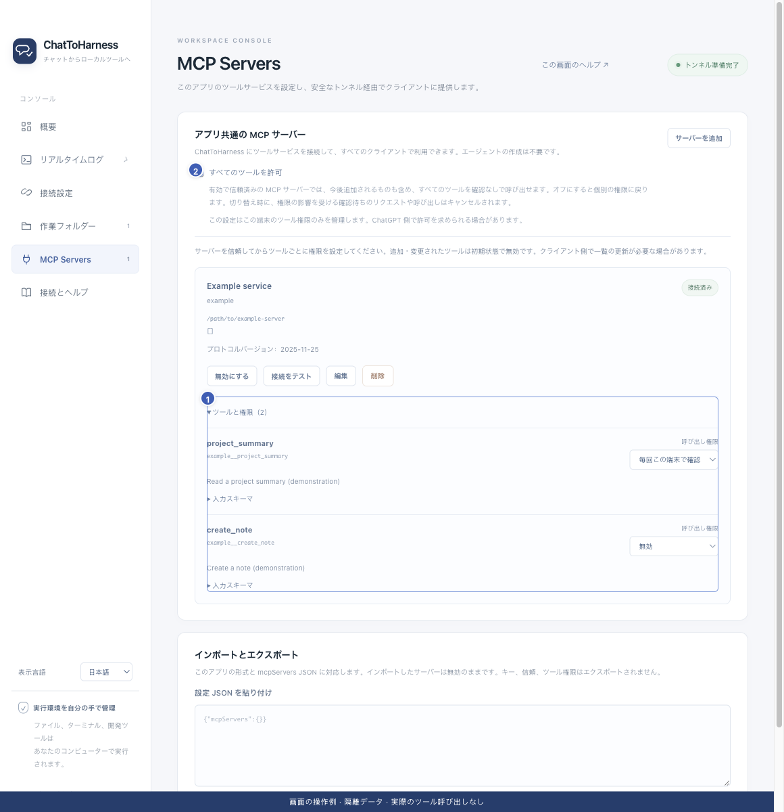

# サービスを編集・有効化・停止・削除する

[English](../en/manage-services.md) | [简体中文](../zh-CN/manage-services.md) | [日本語](../ja/manage-services.md)

> 以下は [ChatToHarness v0.8.1](https://github.com/DJ-Huang/ChatToHarness/releases/tag/v0.8.1) のプラグイン画面での手順です。

## 目的

外部接続を管理し、一つのサービスとトンネル全体を区別します。

## 始める前に

進行中の処理を先に確認し、必要なら完了を待つか明示的に取り消します。

## 操作手順

1. **プラグイン**を開き、対象の外部 MCP サービスのカードで**管理**を選びます。右側に管理パネルが開きます。
2. **概要と権限**で状態とツールを確認します。設定を変更するには**接続設定**に切り替えるか、概要の「編集」を選びます。ID は固定で、起動先が変わると再度信頼の確認が必要です。
3. **概要と権限**の「無効にする」はそのサービスだけを止めます。再び有効にしたら状態を確認します。
4. 削除する場合は同じ概要で「削除」を選び、内容を確認して「削除を確定」を選びます。接続と設定が取り除かれます。
5. 変更後はクライアントの一覧を更新し、読み取りで確認します。

1 ツールと個別権限、2 任意の一括許可。隔離サンプルによる以前の画面例です。v0.8.1 のメニューとパネルの位置は上記の手順に従ってください。実際の接続やツール実行の成功を示す画像ではありません。

## 完了時の状態

同じトンネルを使うクライアントは、現在の有効状態と権限を共有します。

## うまくいかない場合

接続停止はトンネルと管理サービス全体を止めます。ウィンドウを閉じても止まりません。通信障害は個別に再接続しますが、操作は再実行しません。設定削除で第三者ソフトがアンインストールされるわけではありません。

## 次のステップ

- [ツール設定をインポート・エクスポートする](import-export.md)
- [クライアントにトンネルやツールが見つからない](missing-tools.md)
