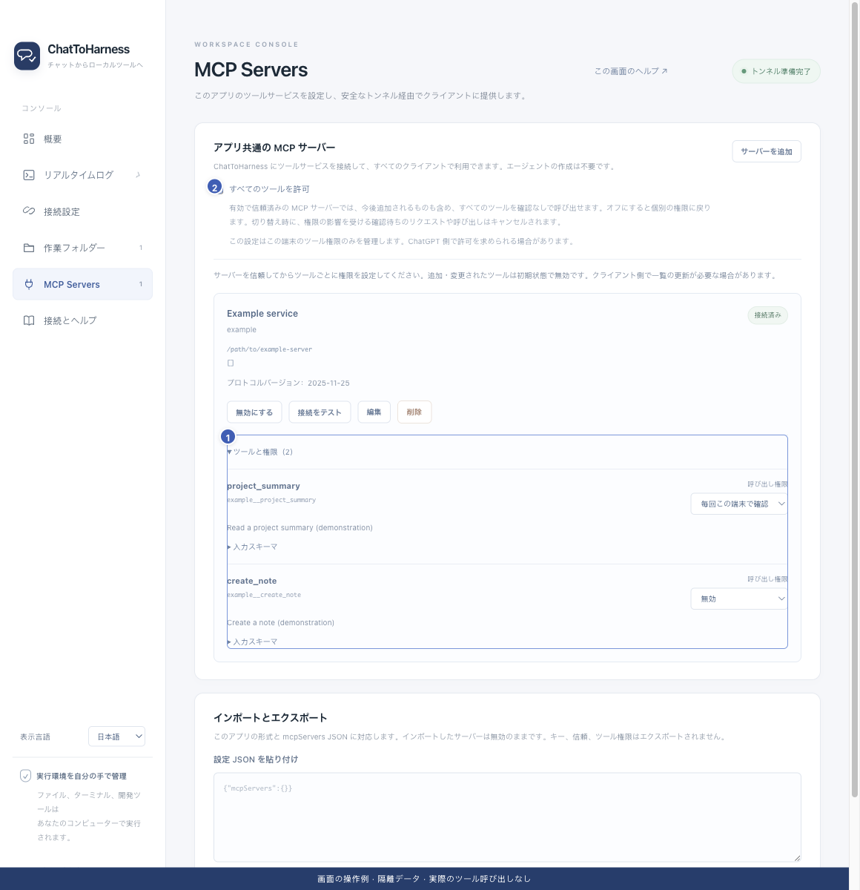

# クライアントにトンネルやツールが見つからない

[English](../en/missing-tools.md) | [简体中文](../zh-CN/missing-tools.md) | [日本語](../ja/missing-tools.md)

> ChatToHarness 0.6.0 対象。

## 目的

アプリ、アカウント、一覧を順に確認します。

## 始める前に

本機のアプリを起動したままにし、内蔵ファイルツールか外部サービスかを区別します。

## 操作手順

1. トンネルがない：対象ワークスペースと組織との関連付け、利用権限を確認します。
2. 本機が未準備：概要の接続エラーを先に解決します。
3. 内蔵ファイルツールがない：許可する作業フォルダーを追加して保存します。
4. 外部ツールがない：サービスを有効化して信頼し、接続後に対象ツールを許可します。
5. クライアントの詳細で一覧を更新し、正しいプラグインを選んで読み取りを試します。名前が LocalHarness の場合もあります。

1 ツールと個別権限、2 任意の一括許可。 現在のリポジトリの画面と隔離サンプルによる操作例です。実際の接続やツール実行の成功を示していません。

## 完了時の状態

許可済みの一覧から実際に呼び出せるようになります。外部ツール名には通常サービス ID が付きます。

## うまくいかない場合

本機のツール数だけでは現在の会話の一覧更新は確認できません。リソース画面がない場合は読み取り用の代替ツールを使います。サービスにない機能は接続しても増えません。

## 次のステップ

- [ChatGPT に接続する](chatgpt.md)
- [Codex に接続する](codex.md)
- [ツールの権限と本機の確認を管理する](tool-permissions.md)
