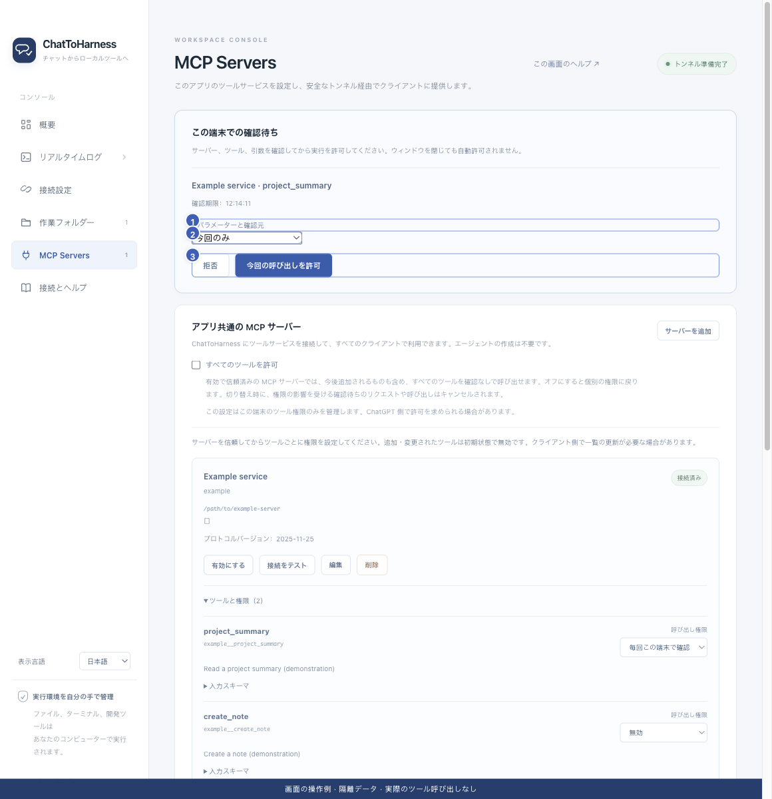

# フォルダー・キー・ツールの権限エラーに対処する

[English](../en/permission-problems.md) | [简体中文](../zh-CN/permission-problems.md) | [日本語](../ja/permission-problems.md)

> 以下のプラグイン操作は [ChatToHarness v0.8.1](https://github.com/DJ-Huang/ChatToHarness/releases/tag/v0.8.1) の画面に対応しています。

## 目的

どの段階で止まったかを調べ、対応する場所で直します。

## 始める前に

正確なエラーを残し、アプリ、OS、サービス、クライアントの許可を区別します。

## 操作手順

1. フォルダーの拒否：作業フォルダーで対象を追加して保存し、絶対パスとリンク先を確認します。
2. キーを読めない：OS の許可画面を処理し、必要ならアプリに再入力します。
3. 外部認証の失敗：**プラグイン**を開き、対象の外部 MCP サービスのカードで**管理**を押します。**接続設定**に切り替え、そのサービスの環境変数やヘッダーのキーを確認します。
4. 無効なツールや未信頼：同じ管理パネルの**概要と権限**でサービスの提供元を確認します。信頼できると判断した場合だけ接続し、現在の作業に必要なツール権限を個別に設定します。
5. 確認の期限切れ：実行済みかを調べてから新しい依頼を送り、時限内に確認します。
6. ChatGPT の確認：独立したクライアント側の許可として確認します。

1 引数確認、2 記憶する範囲、3 拒否または許可。以前の画面例で、隔離サンプルを使用しています。v0.8.1 のメニューと管理パネルの位置は上記の手順に従ってください。実際の接続やツール実行の成功を示すものではありません。

## 完了時の状態

必要な権限だけを調整し、適切な読み取りで確かめます。

## うまくいかない場合

対象プロジェクトのない呼び出しではプロジェクト承認を記憶できない場合があります。変更後は再確認が必要です。チャットから許可フォルダーを書き換えたり、個人ファイル全体を公開したりしないでください。

## 次のステップ

- [サービスを編集・有効化・停止・削除する](manage-services.md)
- [作業フォルダーと工程規約を管理する](work-directories.md)
- [ツールの権限と本機の確認を管理する](tool-permissions.md)
- [接続の認証情報を変更・消去する](credentials.md)
