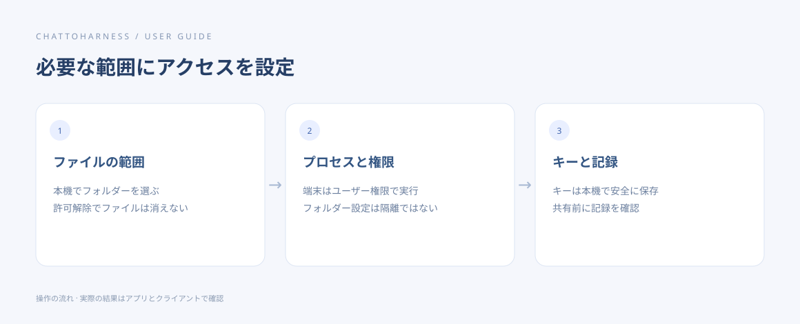

# アクセス範囲・認証情報・記録を理解する

[English](../en/privacy.md) | [简体中文](../zh-CN/privacy.md) | [日本語](../ja/privacy.md)

> ChatToHarness 0.6.0 対象。

## 目的

本機に残る内容と、自分で管理するアクセス範囲を確認します。

## 始める前に

ファイルツール、端末、外部サービス、AI クライアントを区別します。

## 操作手順

1. ファイル：作業フォルダーで許可し、解除してもファイルは消えません。
2. 端末と外部プロセス：ユーザー権限で動作し、フォルダー許可では隔離されません。
3. 認証情報：キーは OS の暗号化で保存され、保存後に値を再表示しません。設定出力には参照だけが残ります。
4. 記録：診断、実行詳細、出力には保存上限があり、内容やパスが含まれる場合があります。共有前に確認します。
5. 結果：関連するツール出力はクライアントへ送られ、各提供元のデータ方針が適用されます。
6. 範囲を狭めるには、フォルダーの解除、ツールの無効化、接続停止を本機で行い、永続タスクは別途取り消します。

操作の順序を示す図です。クライアントが実際に実行した結果ではありません。

## 完了時の状態

必要な範囲にアクセスを設定し、本機の記録とクライアントの結果を区別できます。

## うまくいかない場合

ログが見えないことはデータ不存在の証明ではありません。秘匿処理も完全ではないため、キーを出力・引数・画像に含めないでください。サービス削除でソフトや全履歴が消えるわけではありません。

## 次のステップ

- [作業フォルダーと工程規約を管理する](work-directories.md)
- [ツールの権限と本機の確認を管理する](tool-permissions.md)
- [診断情報・詳細・履歴を書き出す](diagnostics.md)
