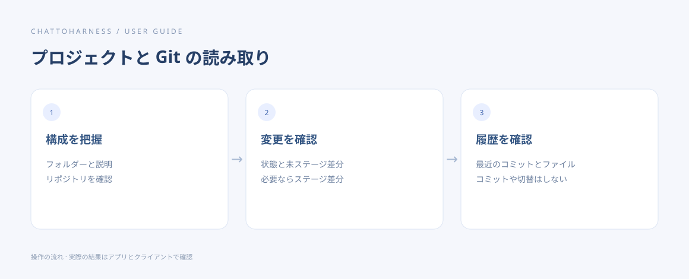

# プロジェクトと Git の変更を確認する

[English](../en/project-git.md) | [简体中文](../zh-CN/project-git.md) | [日本語](../ja/project-git.md)

> ChatToHarness 0.6.0 対象。

## 目的

構成と変更内容、コミット履歴を読み取りで確認します。

## 始める前に

プロジェクトを許可します。Git の確認にはパソコンの Git と、Git 管理された対象が必要です。

## 操作手順

1. 概要を取得し、構成、現在の状態、利用できる説明を把握します。
2. Git の状態から、ステージ済み・未ステージ・未追跡を区別します。
3. 差分は通常未ステージが対象です。ステージ済みや特定ファイルは明示します。
4. 必要な件数やファイルを指定して、最近のコミットを確認します。
5. 要約と実ファイルを対応させ、多い場合は次のページを取得します。

### コピーして使える例文

例のパスは許可済みのプロジェクトの絶対パスに置き換えます。Windows では自分のドライブのパスを使ってください。

```text
/Users/demo/ExampleProject の概要、Git 状態、未ステージの差分を確認して要約してください。コミットや変更はしないでください。
```



操作の順序を示す図です。クライアントが実際に実行した結果ではありません。

## 完了時の状態

実際の構成、変更、履歴が返ります。これらの読み取りでコミットやブランチ切替、編集は行われません。

## うまくいかない場合

Git がない、またはリポジトリでない場合は理由を確認します。通常のファイル読み取りは続けられます。一部の結果や期限切れを見落とさず、差分表示とコミットを区別します。

## 次のステップ

- [ファイル名や内容を検索する](search.md)
- [文書・画像・表計算を読む](reading.md)
