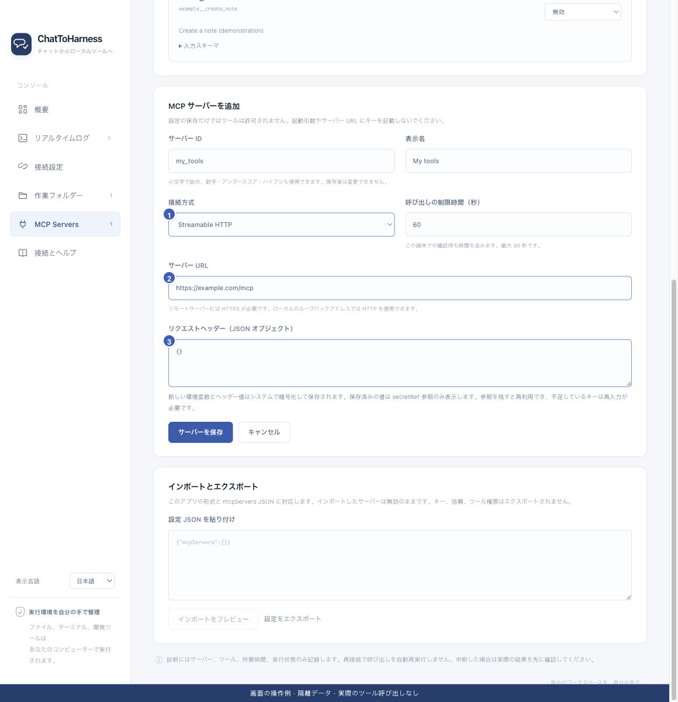

# リモート MCP サービスを追加する

[English](../en/remote-services.md) | [简体中文](../zh-CN/remote-services.md) | [日本語](../ja/remote-services.md)

> ChatToHarness 0.6.0 対象。

## 目的

提供元が用意したリモートツールの接続先を設定します。

## 始める前に

Streamable HTTP の MCP アドレスと認証条件を公式手順で確認します。

## 操作手順

1. MCP Servers で ID と表示名を入力して追加します。
2. Streamable HTTP を選び、接続先を入力します。遠隔先は HTTPS が必須で、HTTP は本機のループバックだけです。
3. 提供元が指定する認証などのヘッダーを設定します。キーを URL やチャットに含めません。
4. 固定キーによる認証に対応するか確認します。この版では OAuth ログインや旧式 HTTP+SSE は使えません。
5. 保存後にアドレスを確認し、接続テストとツールの許可へ進みます。

1 接続方式、2 接続先、3 認証ヘッダー。 現在のリポジトリの画面と隔離サンプルによる操作例です。実際の接続やツール実行の成功を示していません。

## 完了時の状態

一覧に追加され、接続テストの成功後に実際のツールを確認できます。

## うまくいかない場合

ブラウザーでサイトを開けるだけでは MCP 接続先とは限りません。認証失敗時はキーとヘッダーを確認します。トンネルの ID や実行用キーを第三者サービスの認証に使わないでください。

## 次のステップ

- [サービスを信頼して接続テストする](service-trust.md)
- [ツールの権限と本機の確認を管理する](tool-permissions.md)
