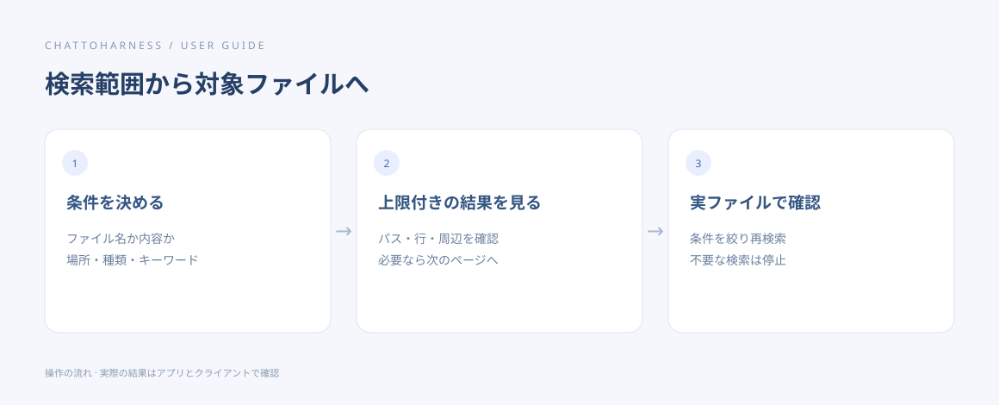

# ファイル名や内容を検索する

[English](../en/search.md) | [简体中文](../zh-CN/search.md) | [日本語](../ja/search.md)

> ChatToHarness 0.6.0 対象。

## 目的

フォルダー内のファイルや、キーワードを含む場所を探します。

## 始める前に

対象を許可し、キーワードとおおよその範囲を決めます。

## 操作手順

1. プロジェクトと、名前を探すのか内容を探すのかを伝えます。
2. 種類、サブフォルダー、除外先を指定します。内容検索は通常の文字列が基本で、パターン検索は必要な場合に明示します。
3. 多数の場合は最初の結果と行番号・周辺を読み、必要なら続きを取得します。
4. 不要になったバックグラウンド検索は停止し、進行中の検索一覧も確認できます。
5. 範囲や語句を調整し、命中したファイルを実際に読んで確認します。

### コピーして使える例文

例のパスは許可済みのプロジェクトの絶対パスに置き換えます。Windows では自分のドライブのパスを使ってください。

```text
/Users/demo/ExampleProject の Markdown から「公開計画」を検索し、パス・行番号・周辺内容を示してください。変更しないでください。
```



操作の順序を示す図です。クライアントが実際に実行した結果ではありません。

## 完了時の状態

名前検索はパス、内容検索はパス・行番号・周辺テキストを返します。該当なしと一部の結果は区別されます。

## うまくいかない場合

時間と件数には上限があります。一部の結果だけで全件確認とはいえません。除外対象やバイナリは通常スキップします。結果のページが期限切れなら検索し直します。

## 次のステップ

- [文書・画像・表計算を読む](reading.md)
- [ファイルを探して整理する](files.md)
