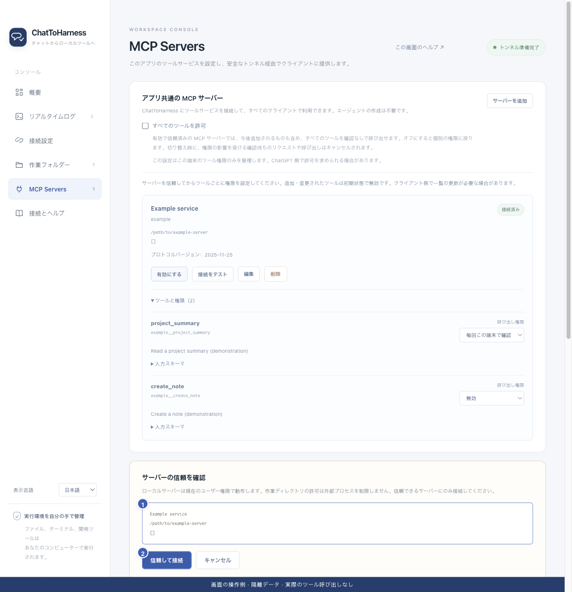

# サービスを信頼して接続テストする

[English](../en/service-trust.md) | [简体中文](../zh-CN/service-trust.md) | [日本語](../ja/service-trust.md)

> ChatToHarness 0.6.0 対象。

## 目的

外部サービスを有効にする前に、実際の起動先を確認します。

## 始める前に

設定を保存し、信頼できる提供元であることを確認します。

## 操作手順

1. サービスカードで接続テストまたは有効化を選びます。
2. 信頼確認で名前、コマンドと引数、または URL を照合します。不明なら取消して公式手順を確認します。
3. 確認後、信頼してテストまたは信頼して接続を選びます。
4. 状態とツール一覧を確認し、必要な権限を設定します。
5. 起動先を変更した場合は、もう一度信頼を確認します。

1 実際の接続先、2 信頼の確認。 現在のリポジトリの画面と隔離サンプルによる操作例です。実際の接続やツール実行の成功を示していません。

## 完了時の状態

テストは接続とツールの検出を確認し、見つかった業務ツールは呼び出しません。正常な接続は再利用します。

## うまくいかない場合

信頼とツールの許可は別です。失敗時はコマンド、ネットワーク、認証を確認します。接続テストの成功だけでは個々の業務操作を保証しないため、許可後に適切な読み取り操作で確かめます。

## 次のステップ

- [ツールの権限と本機の確認を管理する](tool-permissions.md)
- [サービスを編集・有効化・停止・削除する](manage-services.md)
