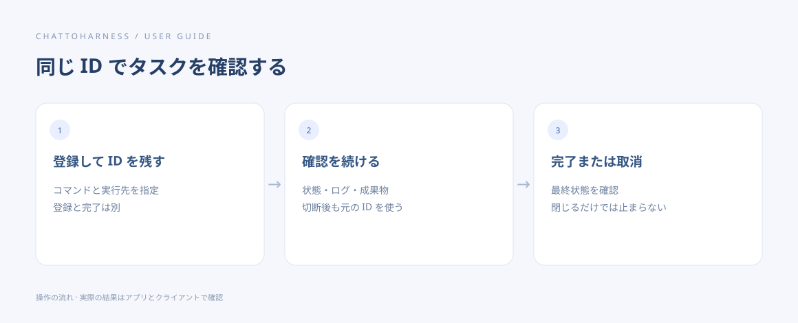

# コマンドと対話セッションを使う

[English](../en/terminal.md) | [简体中文](../zh-CN/terminal.md) | [日本語](../ja/terminal.md)

> ChatToHarness 0.6.0 対象。

## 目的

具体的なコマンドを本機で実行し、必要に応じて入力や出力確認を続けます。

## 始める前に

必要なコマンドをインストールし、実行するディレクトリを把握します。現在のユーザー権限で動作します。

## 操作手順

1. コマンド、実際の実行先、期待する結果を具体的に伝えます。
2. 短い処理は出力と終了状態を確認します。
3. 対話型では返されたセッション識別子を残し、追加の入力や出力確認に使います。
4. 一覧から対象のセッションを見つけ、そのセッションだけを停止します。
5. 長時間の処理や再接続後も確認したい処理は永続バックグラウンドタスクを使います。

### コピーして使える例文

例のパスは許可済みのプロジェクトの絶対パスに置き換えます。Windows では自分のドライブのパスを使ってください。

```text
/Users/demo/ExampleProject で現在のディレクトリと Git のバージョンを読み取りだけで確認し、出力と終了状態を返してください。
```



操作の順序を示す図です。クライアントが実際に実行した結果ではありません。

プロセスの調査では先に本機の一覧で対象を特定してから終了を依頼し、無関係なプログラムを止めないでください。

## 完了時の状態

実行中、入力待ち、終了を区別して出力を確認できます。後の操作にはセッション識別子を使います。

## うまくいかない場合

作業フォルダーの許可はターミナルを隔離しません。コマンドはネットワークや他の場所にもアクセスできます。タイムアウト時も実行済みの場合があります。再接続後は状態を確認してから再実行します。

## 次のステップ

- [バックグラウンドタスクを開始・確認・取消する](background-tasks.md)
- [タイムアウト・状態不明・返答なしに対処する](uncertain-results.md)
- [アクセス範囲・認証情報・記録を理解する](privacy.md)
